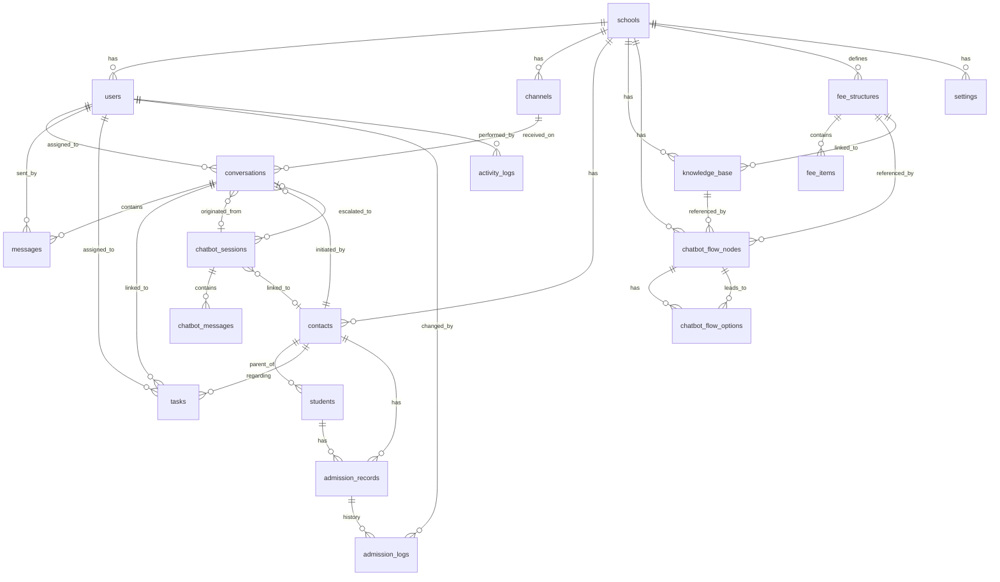

# ERD — Kreativa Connect
**Entity Relationship Document & PostgreSQL Schema**
Version 1.0 | October 2026

> Rules applied:
> - Primary keys: `BIGSERIAL` (no UUID)
> - Enum-like columns: `VARCHAR(50)` with a `CHECK` constraint
> - High-traffic indexes: composite, partial, and GIN indexes on frequently queried columns
> - All foreign keys declared explicitly
> - `school_id` on every tenant-scoped table for multi-school readiness
> - `created_at` / `updated_at` on every table (auto-managed via trigger)

---

## Table of Contents
1. [Entity Relationship Diagram (Mermaid)](#erd-diagram)
2. [Schema DDL](#schema-ddl)
3. [Realistic Seed Data](#seed-data)

---

## 1. Entity Relationship Diagram



---

## 2. Schema DDL

```sql
-- ============================================================
-- EXTENSIONS
-- ============================================================
CREATE EXTENSION IF NOT EXISTS pg_trgm;   -- trigram for ILIKE fast search
CREATE EXTENSION IF NOT EXISTS unaccent;  -- accent-insensitive search

-- ============================================================
-- HELPER: auto-update updated_at
-- ============================================================
CREATE OR REPLACE FUNCTION trigger_set_updated_at()
RETURNS TRIGGER AS $$
BEGIN
  NEW.updated_at = NOW();
  RETURN NEW;
END;
$$ LANGUAGE plpgsql;

-- ============================================================
-- TABLE: schools
-- Multi-tenant root. Every tenant-scoped table has school_id.
-- ============================================================
CREATE TABLE schools (
  id          BIGSERIAL PRIMARY KEY,
  name        VARCHAR(255) NOT NULL,
  slug        VARCHAR(100) NOT NULL UNIQUE,   -- e.g. 'kreativa-global'
  domain      VARCHAR(255),                   -- school website domain
  logo_url    TEXT,
  is_active   BOOLEAN NOT NULL DEFAULT TRUE,
  created_at  TIMESTAMPTZ NOT NULL DEFAULT NOW(),
  updated_at  TIMESTAMPTZ NOT NULL DEFAULT NOW()
);
CREATE TRIGGER trg_schools_updated_at
  BEFORE UPDATE ON schools
  FOR EACH ROW EXECUTE FUNCTION trigger_set_updated_at();

-- ============================================================
-- TABLE: users  (admin panel staff)
-- role: 'super_admin' | 'admission_pic' | 'class_pro' | 'finance' | 'academic'
-- ============================================================
CREATE TABLE users (
  id            BIGSERIAL PRIMARY KEY,
  school_id     BIGINT NOT NULL REFERENCES schools(id) ON DELETE CASCADE,
  full_name     VARCHAR(255) NOT NULL,
  email         VARCHAR(255) NOT NULL,
  password_hash TEXT NOT NULL,
  role          VARCHAR(50) NOT NULL
                  CHECK (role IN ('super_admin','admission_pic','class_pro','finance','academic')),
  display_name  VARCHAR(100),                -- e.g. 'Ms. Syaidah'
  avatar_url    TEXT,
  is_active     BOOLEAN NOT NULL DEFAULT TRUE,
  last_login_at TIMESTAMPTZ,
  created_at    TIMESTAMPTZ NOT NULL DEFAULT NOW(),
  updated_at    TIMESTAMPTZ NOT NULL DEFAULT NOW(),
  UNIQUE (school_id, email)
);
CREATE INDEX idx_users_school_role ON users (school_id, role);
CREATE INDEX idx_users_email ON users (email);
CREATE TRIGGER trg_users_updated_at
  BEFORE UPDATE ON users
  FOR EACH ROW EXECUTE FUNCTION trigger_set_updated_at();

-- ============================================================
-- TABLE: channels  (WhatsApp numbers / chat channels)
-- ============================================================
CREATE TABLE channels (
  id          BIGSERIAL PRIMARY KEY,
  school_id   BIGINT NOT NULL REFERENCES schools(id) ON DELETE CASCADE,
  name        VARCHAR(100) NOT NULL,           -- e.g. 'Admission', 'KG PRO'
  phone       VARCHAR(30),                     -- WhatsApp number
  type        VARCHAR(50) NOT NULL DEFAULT 'whatsapp'
                CHECK (type IN ('whatsapp','web_chat','email')),
  default_assigned_user_id BIGINT REFERENCES users(id) ON DELETE SET NULL,
  is_active   BOOLEAN NOT NULL DEFAULT TRUE,
  created_at  TIMESTAMPTZ NOT NULL DEFAULT NOW(),
  updated_at  TIMESTAMPTZ NOT NULL DEFAULT NOW()
);
CREATE INDEX idx_channels_school ON channels (school_id);
CREATE TRIGGER trg_channels_updated_at
  BEFORE UPDATE ON channels
  FOR EACH ROW EXECUTE FUNCTION trigger_set_updated_at();

-- ============================================================
-- TABLE: contacts  (parents — prospective or active)
-- contact_type: 'prospective' | 'active_parent'
-- lead_temp:    'hot' | 'warm' | 'cold'
-- edu_level:    'kindergarten_1' | 'kindergarten_2' | 'primary' | 'secondary' | 'high_school'
-- ============================================================
CREATE TABLE contacts (
  id              BIGSERIAL PRIMARY KEY,
  school_id       BIGINT NOT NULL REFERENCES schools(id) ON DELETE CASCADE,
  assigned_user_id BIGINT REFERENCES users(id) ON DELETE SET NULL,
  full_name       VARCHAR(255) NOT NULL,
  phone           VARCHAR(30) NOT NULL,        -- WhatsApp number used for identification
  email           VARCHAR(255),
  contact_type    VARCHAR(50) NOT NULL DEFAULT 'prospective'
                    CHECK (contact_type IN ('prospective','active_parent')),
  lead_temp       VARCHAR(20)
                    CHECK (lead_temp IN ('hot','warm','cold')),
  edu_level       VARCHAR(50)
                    CHECK (edu_level IN (
                      'kindergarten_1','kindergarten_2','primary','secondary','high_school'
                    )),
  internal_notes  TEXT,
  search_vector   TSVECTOR,                    -- full-text search
  created_at      TIMESTAMPTZ NOT NULL DEFAULT NOW(),
  updated_at      TIMESTAMPTZ NOT NULL DEFAULT NOW()
);
-- High-traffic: phone lookup (WhatsApp identification)
CREATE UNIQUE INDEX idx_contacts_school_phone ON contacts (school_id, phone);
CREATE INDEX idx_contacts_school_type  ON contacts (school_id, contact_type);
CREATE INDEX idx_contacts_school_level ON contacts (school_id, edu_level);
CREATE INDEX idx_contacts_assigned     ON contacts (assigned_user_id) WHERE assigned_user_id IS NOT NULL;
CREATE INDEX idx_contacts_fts          ON contacts USING GIN (search_vector);
CREATE TRIGGER trg_contacts_updated_at
  BEFORE UPDATE ON contacts
  FOR EACH ROW EXECUTE FUNCTION trigger_set_updated_at();

-- Trigger: keep search_vector in sync
CREATE OR REPLACE FUNCTION contacts_search_vector_update() RETURNS TRIGGER AS $$
BEGIN
  NEW.search_vector :=
    setweight(to_tsvector('simple', COALESCE(NEW.full_name,'')), 'A') ||
    setweight(to_tsvector('simple', COALESCE(NEW.phone,'')), 'B') ||
    setweight(to_tsvector('simple', COALESCE(NEW.email,'')), 'C');
  RETURN NEW;
END;
$$ LANGUAGE plpgsql;
CREATE TRIGGER trg_contacts_fts
  BEFORE INSERT OR UPDATE ON contacts
  FOR EACH ROW EXECUTE FUNCTION contacts_search_vector_update();

-- ============================================================
-- TABLE: students  (children linked to a contact/parent)
-- ============================================================
CREATE TABLE students (
  id          BIGSERIAL PRIMARY KEY,
  school_id   BIGINT NOT NULL REFERENCES schools(id) ON DELETE CASCADE,
  contact_id  BIGINT NOT NULL REFERENCES contacts(id) ON DELETE CASCADE,
  full_name   VARCHAR(255) NOT NULL,
  birth_date  DATE,
  edu_level   VARCHAR(50)
                CHECK (edu_level IN (
                  'kindergarten_1','kindergarten_2','primary','secondary','high_school'
                )),
  student_number VARCHAR(50),                  -- if already enrolled
  created_at  TIMESTAMPTZ NOT NULL DEFAULT NOW(),
  updated_at  TIMESTAMPTZ NOT NULL DEFAULT NOW()
);
CREATE INDEX idx_students_contact ON students (contact_id);
CREATE INDEX idx_students_school  ON students (school_id);
CREATE TRIGGER trg_students_updated_at
  BEFORE UPDATE ON students
  FOR EACH ROW EXECUTE FUNCTION trigger_set_updated_at();

-- ============================================================
-- TABLE: admission_records
-- One record per student per academic year.
-- stage: 10 values as VARCHAR
-- ============================================================
CREATE TABLE admission_records (
  id            BIGSERIAL PRIMARY KEY,
  school_id     BIGINT NOT NULL REFERENCES schools(id) ON DELETE CASCADE,
  student_id    BIGINT NOT NULL REFERENCES students(id) ON DELETE CASCADE,
  contact_id    BIGINT NOT NULL REFERENCES contacts(id) ON DELETE CASCADE,
  academic_year VARCHAR(20) NOT NULL DEFAULT '2026/2027',
  stage         VARCHAR(60) NOT NULL DEFAULT 'registered'
                  CHECK (stage IN (
                    'registered','assessment_scheduled','assessment_completed',
                    'parent_interview','selection_result','accepted',
                    'confirmation_letter_pending','first_payment_pending',
                    'payment_verification','enrollment_completed'
                  )),
  is_active     BOOLEAN NOT NULL DEFAULT TRUE,
  created_at    TIMESTAMPTZ NOT NULL DEFAULT NOW(),
  updated_at    TIMESTAMPTZ NOT NULL DEFAULT NOW()
);
CREATE INDEX idx_admission_school_stage  ON admission_records (school_id, stage);
CREATE INDEX idx_admission_student       ON admission_records (student_id);
CREATE INDEX idx_admission_contact       ON admission_records (contact_id);
CREATE TRIGGER trg_admission_updated_at
  BEFORE UPDATE ON admission_records
  FOR EACH ROW EXECUTE FUNCTION trigger_set_updated_at();

-- ============================================================
-- TABLE: admission_logs
-- Append-only history of stage changes.
-- ============================================================
CREATE TABLE admission_logs (
  id                    BIGSERIAL PRIMARY KEY,
  admission_record_id   BIGINT NOT NULL REFERENCES admission_records(id) ON DELETE CASCADE,
  changed_by_user_id    BIGINT REFERENCES users(id) ON DELETE SET NULL,
  previous_stage        VARCHAR(60),
  new_stage             VARCHAR(60) NOT NULL,
  notes                 TEXT,
  created_at            TIMESTAMPTZ NOT NULL DEFAULT NOW()
);
CREATE INDEX idx_admlog_record ON admission_logs (admission_record_id);
CREATE INDEX idx_admlog_user   ON admission_logs (changed_by_user_id) WHERE changed_by_user_id IS NOT NULL;

-- ============================================================
-- TABLE: conversations
-- status:   'new' | 'in_progress' | 'pending_internal' | 'pending_parent' | 'needs_followup' | 'closed'
-- priority: 'low' | 'medium' | 'high'
-- ============================================================
CREATE TABLE conversations (
  id                      BIGSERIAL PRIMARY KEY,
  school_id               BIGINT NOT NULL REFERENCES schools(id) ON DELETE CASCADE,
  contact_id              BIGINT NOT NULL REFERENCES contacts(id) ON DELETE CASCADE,
  channel_id              BIGINT NOT NULL REFERENCES channels(id) ON DELETE RESTRICT,
  assigned_user_id        BIGINT REFERENCES users(id) ON DELETE SET NULL,
  chatbot_session_id      BIGINT,              -- set after chatbot handover (FK added below)
  topic                   VARCHAR(255),
  status                  VARCHAR(50) NOT NULL DEFAULT 'new'
                            CHECK (status IN (
                              'new','in_progress','pending_internal',
                              'pending_parent','needs_followup','closed'
                            )),
  priority                VARCHAR(20) NOT NULL DEFAULT 'medium'
                            CHECK (priority IN ('low','medium','high')),
  first_response_secs     INT,                 -- seconds from first parent msg to first agent reply
  closed_at               TIMESTAMPTZ,
  search_vector           TSVECTOR,
  created_at              TIMESTAMPTZ NOT NULL DEFAULT NOW(),
  updated_at              TIMESTAMPTZ NOT NULL DEFAULT NOW()
);
-- High-traffic: inbox list (status + school + updated_at)
CREATE INDEX idx_conv_school_status    ON conversations (school_id, status, updated_at DESC);
CREATE INDEX idx_conv_contact          ON conversations (contact_id);
CREATE INDEX idx_conv_channel          ON conversations (channel_id);
CREATE INDEX idx_conv_assigned         ON conversations (assigned_user_id) WHERE assigned_user_id IS NOT NULL;
-- Partial: only open conversations (inbox performance)
CREATE INDEX idx_conv_open             ON conversations (school_id, updated_at DESC)
  WHERE status NOT IN ('closed');
CREATE INDEX idx_conv_fts              ON conversations USING GIN (search_vector);
CREATE TRIGGER trg_conv_updated_at
  BEFORE UPDATE ON conversations
  FOR EACH ROW EXECUTE FUNCTION trigger_set_updated_at();

-- ============================================================
-- TABLE: messages
-- role:   'parent' | 'agent' | 'bot' | 'internal_note'
-- source: 'human' | 'ai' | 'system'
-- ============================================================
CREATE TABLE messages (
  id               BIGSERIAL PRIMARY KEY,
  conversation_id  BIGINT NOT NULL REFERENCES conversations(id) ON DELETE CASCADE,
  sent_by_user_id  BIGINT REFERENCES users(id) ON DELETE SET NULL,  -- NULL if from parent/bot
  role             VARCHAR(30) NOT NULL
                     CHECK (role IN ('parent','agent','bot','internal_note')),
  source           VARCHAR(20) NOT NULL DEFAULT 'human'
                     CHECK (source IN ('human','ai','system')),
  content          TEXT NOT NULL,
  is_visible_to_parent BOOLEAN NOT NULL DEFAULT TRUE,  -- FALSE for internal_note
  created_at       TIMESTAMPTZ NOT NULL DEFAULT NOW()
  -- no updated_at: messages are immutable
);
-- High-traffic: load all messages in a conversation sorted by time
CREATE INDEX idx_msg_conv_created   ON messages (conversation_id, created_at ASC);
CREATE INDEX idx_msg_role           ON messages (conversation_id, role);

-- ============================================================
-- TABLE: tasks  (follow-up items)
-- ============================================================
CREATE TABLE tasks (
  id               BIGSERIAL PRIMARY KEY,
  school_id        BIGINT NOT NULL REFERENCES schools(id) ON DELETE CASCADE,
  contact_id       BIGINT NOT NULL REFERENCES contacts(id) ON DELETE CASCADE,
  conversation_id  BIGINT REFERENCES conversations(id) ON DELETE SET NULL,
  assigned_user_id BIGINT REFERENCES users(id) ON DELETE SET NULL,
  title            VARCHAR(500) NOT NULL,
  due_at           TIMESTAMPTZ NOT NULL,
  is_done          BOOLEAN NOT NULL DEFAULT FALSE,
  done_at          TIMESTAMPTZ,
  created_at       TIMESTAMPTZ NOT NULL DEFAULT NOW(),
  updated_at       TIMESTAMPTZ NOT NULL DEFAULT NOW()
);
-- High-traffic: overdue task badge count
CREATE INDEX idx_tasks_school_due   ON tasks (school_id, due_at)
  WHERE is_done = FALSE;
CREATE INDEX idx_tasks_assigned     ON tasks (assigned_user_id, is_done, due_at);
CREATE INDEX idx_tasks_contact      ON tasks (contact_id);
CREATE INDEX idx_tasks_conv         ON tasks (conversation_id) WHERE conversation_id IS NOT NULL;
CREATE TRIGGER trg_tasks_updated_at
  BEFORE UPDATE ON tasks
  FOR EACH ROW EXECUTE FUNCTION trigger_set_updated_at();

-- ============================================================
-- TABLE: fee_structures
-- Master fee schedule/package per school, campus, academic year, level, and payment scheme.
-- Accommodates both Kreativa Global School and Sekolah Talenta Juara (Bandung, Cimahi, Pekanbaru).
-- ============================================================
CREATE TABLE fee_structures (
  id                BIGSERIAL PRIMARY KEY,
  school_id         BIGINT NOT NULL REFERENCES schools(id) ON DELETE CASCADE,
  campus            VARCHAR(100) NOT NULL DEFAULT 'Main',       -- e.g. 'Bandung', 'Cimahi', 'Pekanbaru', 'Main'
  academic_year     VARCHAR(20) NOT NULL DEFAULT '2027/2028',   -- e.g. '2026/2027', '2027/2028'
  edu_level         VARCHAR(50) NOT NULL
                      CHECK (edu_level IN (
                        'kindergarten','kindergarten_1','kindergarten_2',
                        'primary','secondary','high_school'
                      )),
  level_name        VARCHAR(100) NOT NULL,                      -- e.g. 'SD Talenta Juara Bandung', 'Primary School', 'Secondary School', 'High School', 'Kindergarten'
  scheme_name       VARCHAR(100) NOT NULL DEFAULT 'Standard',   -- e.g. 'Standard', 'Scheme 1: One-Time Enrollment Fee', 'Scheme 2: Two-Times Enrollment Fee', 'Scheme 3: Six-Times Enrollment Fee', 'Scheme 2: Three-Time Enrollment Fee'
  registration_fee  NUMERIC(14, 2) NOT NULL DEFAULT 0,          -- e.g. 300000.00 or 1000000.00
  currency          VARCHAR(10) NOT NULL DEFAULT 'IDR',
  inclusions        TEXT,                                       -- School facilities, activities, curriculum, uniforms, lunch, etc.
  exclusions        TEXT,                                       -- Field trips, Cambridge checkpoint, extracurriculars, etc.
  notes             TEXT,                                       -- e.g. 'Semua pembayaran yang telah dilakukan tidak dapat ditarik kembali (non-refundable).'
  brochure_url      TEXT,
  matrix_json       JSONB,                                      -- Pre-formatted matrix JSON for instant frontend/widget rendering
  is_active         BOOLEAN NOT NULL DEFAULT TRUE,
  created_at        TIMESTAMPTZ NOT NULL DEFAULT NOW(),
  updated_at        TIMESTAMPTZ NOT NULL DEFAULT NOW(),
  UNIQUE (school_id, campus, academic_year, edu_level, scheme_name)
);
-- High-traffic indexes for fee lookups
CREATE INDEX idx_feestr_school_campus_level ON fee_structures (school_id, campus, edu_level, is_active);
CREATE INDEX idx_feestr_active_year ON fee_structures (school_id, academic_year) WHERE is_active = TRUE;
CREATE TRIGGER trg_fee_structures_updated_at
  BEFORE UPDATE ON fee_structures
  FOR EACH ROW EXECUTE FUNCTION trigger_set_updated_at();

-- ============================================================
-- TABLE: fee_items
-- Detailed fee components per grade/year, fee category, billing period, and amount.
-- Accommodates DSP, SPP, DKT, Enrollment Fee, Program Fee, Tuition Fee, and Annual Packages.
-- ============================================================
CREATE TABLE fee_items (
  id                BIGSERIAL PRIMARY KEY,
  fee_structure_id  BIGINT NOT NULL REFERENCES fee_structures(id) ON DELETE CASCADE,
  grade_label       VARCHAR(50) NOT NULL,                       -- e.g. 'Th 1', 'Th 2', 'P1', 'P2', 'S1', 'S4', 'JC1', 'K1', 'All'
  grade_order       INT NOT NULL DEFAULT 1,                     -- Sorting: 1, 2, 3, 4, 5, 6
  item_name         VARCHAR(100) NOT NULL,                      -- e.g. 'DSP', 'SPP', 'DKT', 'Enrollment Fee', 'Annual Program Fee', 'Monthly Tuition Fee', 'Annual Tuition Fee'
  fee_category      VARCHAR(50) NOT NULL
                      CHECK (fee_category IN (
                        'registration',         -- Biaya Pendaftaran
                        'dsp_enrollment',       -- DSP / One-time or Installment Enrollment Fee
                        'spp_tuition',          -- SPP / Monthly Tuition
                        'dkt_program',          -- DKT / Annual Program Fee
                        'annual_package',       -- Annual Tuition Fee (e.g. Kindergarten)
                        'facility_materials',   -- Books, uniform, facilities
                        'other'
                      )),
  billing_period    VARCHAR(50) NOT NULL
                      CHECK (billing_period IN ('once', 'monthly', 'annually', 'per_term', 'other')),
  period_label      VARCHAR(50) NOT NULL,                       -- e.g. '1 Kali di Awal', 'Per Bulan', 'Per Tahun', 'Annual'
  amount            NUMERIC(14, 2) NOT NULL DEFAULT 0,
  notes             VARCHAR(255),
  created_at        TIMESTAMPTZ NOT NULL DEFAULT NOW(),
  updated_at        TIMESTAMPTZ NOT NULL DEFAULT NOW()
);
-- High-traffic indexes for loading ordered fee table
CREATE INDEX idx_feeitems_structure_order ON fee_items (fee_structure_id, grade_order ASC, item_name ASC);
CREATE INDEX idx_feeitems_category ON fee_items (fee_category, billing_period);
CREATE TRIGGER trg_fee_items_updated_at
  BEFORE UPDATE ON fee_items
  FOR EACH ROW EXECUTE FUNCTION trigger_set_updated_at();

-- ============================================================
-- TABLE: knowledge_base  (FAQ / approved answers)
-- ============================================================
CREATE TABLE knowledge_base (
  id                BIGSERIAL PRIMARY KEY,
  school_id         BIGINT NOT NULL REFERENCES schools(id) ON DELETE CASCADE,
  fee_structure_id  BIGINT REFERENCES fee_structures(id) ON DELETE SET NULL,
  created_by_id     BIGINT REFERENCES users(id) ON DELETE SET NULL,
  title             VARCHAR(500) NOT NULL,
  category          VARCHAR(100) NOT NULL
                      CHECK (category IN (
                        'school_info','fees','enrollment','visit',
                        'admission','existing_parent','other'
                      )),
  edu_level_scope   VARCHAR(50) NOT NULL DEFAULT 'all'
                      CHECK (edu_level_scope IN (
                        'all','kindergarten_1','kindergarten_2',
                        'primary','secondary','high_school'
                      )),
  answer            TEXT NOT NULL,
  is_active         BOOLEAN NOT NULL DEFAULT TRUE,
  search_vector     TSVECTOR,
  created_at        TIMESTAMPTZ NOT NULL DEFAULT NOW(),
  updated_at        TIMESTAMPTZ NOT NULL DEFAULT NOW()
);
CREATE INDEX idx_kb_school_active   ON knowledge_base (school_id, is_active);
CREATE INDEX idx_kb_school_category ON knowledge_base (school_id, category);
CREATE INDEX idx_kb_fee_structure   ON knowledge_base (fee_structure_id) WHERE fee_structure_id IS NOT NULL;
CREATE INDEX idx_kb_fts             ON knowledge_base USING GIN (search_vector);
CREATE TRIGGER trg_kb_updated_at
  BEFORE UPDATE ON knowledge_base
  FOR EACH ROW EXECUTE FUNCTION trigger_set_updated_at();

CREATE OR REPLACE FUNCTION kb_search_vector_update() RETURNS TRIGGER AS $$
BEGIN
  NEW.search_vector :=
    setweight(to_tsvector('simple', COALESCE(NEW.title,'')), 'A') ||
    setweight(to_tsvector('simple', COALESCE(NEW.answer,'')), 'B');
  RETURN NEW;
END;
$$ LANGUAGE plpgsql;
CREATE TRIGGER trg_kb_fts
  BEFORE INSERT OR UPDATE ON knowledge_base
  FOR EACH ROW EXECUTE FUNCTION kb_search_vector_update();

-- ============================================================
-- TABLE: chatbot_flow_nodes  (branching tree nodes)
-- node_type: 'message' | 'question' | 'faq_answer' | 'fee_quote' | 'ai_response' | 'handover' | 'end'
-- ============================================================
CREATE TABLE chatbot_flow_nodes (
  id                BIGSERIAL PRIMARY KEY,
  school_id         BIGINT NOT NULL REFERENCES schools(id) ON DELETE CASCADE,
  faq_id            BIGINT REFERENCES knowledge_base(id) ON DELETE SET NULL,
  fee_structure_id  BIGINT REFERENCES fee_structures(id) ON DELETE SET NULL,
  is_root           BOOLEAN NOT NULL DEFAULT FALSE,
  node_type         VARCHAR(30) NOT NULL DEFAULT 'message'
                      CHECK (node_type IN (
                        'message','question','faq_answer','fee_quote',
                        'ai_response','handover','end'
                      )),
  message_text      TEXT NOT NULL,              -- shown to parent before options
  ai_fallback_text  TEXT,                       -- shown if AI API is unavailable
  handover_team     VARCHAR(100),               -- team label for handover type
  sort_order        INT NOT NULL DEFAULT 0,     -- for ordering sibling nodes
  is_active         BOOLEAN NOT NULL DEFAULT TRUE,
  created_at        TIMESTAMPTZ NOT NULL DEFAULT NOW(),
  updated_at        TIMESTAMPTZ NOT NULL DEFAULT NOW()
);
-- Only one root per school
CREATE UNIQUE INDEX idx_cfn_school_root ON chatbot_flow_nodes (school_id)
  WHERE is_root = TRUE;
CREATE INDEX idx_cfn_school_active ON chatbot_flow_nodes (school_id, is_active);
CREATE INDEX idx_cfn_fee_struct    ON chatbot_flow_nodes (fee_structure_id) WHERE fee_structure_id IS NOT NULL;
CREATE TRIGGER trg_cfn_updated_at
  BEFORE UPDATE ON chatbot_flow_nodes
  FOR EACH ROW EXECUTE FUNCTION trigger_set_updated_at();

-- ============================================================
-- TABLE: chatbot_flow_options  (buttons / choices on each node)
-- ============================================================
CREATE TABLE chatbot_flow_options (
  id            BIGSERIAL PRIMARY KEY,
  node_id       BIGINT NOT NULL REFERENCES chatbot_flow_nodes(id) ON DELETE CASCADE,
  next_node_id  BIGINT NOT NULL REFERENCES chatbot_flow_nodes(id) ON DELETE RESTRICT,
  label         VARCHAR(500) NOT NULL,         -- button text shown to parent
  sort_order    INT NOT NULL DEFAULT 0,
  is_active     BOOLEAN NOT NULL DEFAULT TRUE,
  created_at    TIMESTAMPTZ NOT NULL DEFAULT NOW(),
  updated_at    TIMESTAMPTZ NOT NULL DEFAULT NOW()
);
CREATE INDEX idx_cfo_node         ON chatbot_flow_options (node_id, sort_order) WHERE is_active = TRUE;
CREATE INDEX idx_cfo_next_node    ON chatbot_flow_options (next_node_id);
CREATE TRIGGER trg_cfo_updated_at
  BEFORE UPDATE ON chatbot_flow_options
  FOR EACH ROW EXECUTE FUNCTION trigger_set_updated_at();

-- ============================================================
-- TABLE: chatbot_sessions  (one per parent widget visit)
-- status: 'active' | 'handed_over' | 'ended'
-- ============================================================
CREATE TABLE chatbot_sessions (
  id               BIGSERIAL PRIMARY KEY,
  school_id        BIGINT NOT NULL REFERENCES schools(id) ON DELETE CASCADE,
  contact_id       BIGINT REFERENCES contacts(id) ON DELETE SET NULL,
  conversation_id  BIGINT REFERENCES conversations(id) ON DELETE SET NULL,
  session_token    VARCHAR(128) NOT NULL UNIQUE,   -- browser token
  status           VARCHAR(30) NOT NULL DEFAULT 'active'
                     CHECK (status IN ('active','handed_over','ended')),
  current_node_id  BIGINT REFERENCES chatbot_flow_nodes(id) ON DELETE SET NULL,
  parent_name      VARCHAR(255),                   -- collected during session if not linked
  parent_phone     VARCHAR(30),
  ip_address       INET,
  user_agent       TEXT,
  expires_at       TIMESTAMPTZ NOT NULL DEFAULT (NOW() + INTERVAL '24 hours'),
  created_at       TIMESTAMPTZ NOT NULL DEFAULT NOW(),
  updated_at       TIMESTAMPTZ NOT NULL DEFAULT NOW()
);
CREATE INDEX idx_csess_token       ON chatbot_sessions (session_token);
CREATE INDEX idx_csess_school_status ON chatbot_sessions (school_id, status, created_at DESC);
CREATE INDEX idx_csess_contact     ON chatbot_sessions (contact_id) WHERE contact_id IS NOT NULL;
CREATE TRIGGER trg_csess_updated_at
  BEFORE UPDATE ON chatbot_sessions
  FOR EACH ROW EXECUTE FUNCTION trigger_set_updated_at();

-- Back-fill FK on conversations
ALTER TABLE conversations
  ADD CONSTRAINT fk_conv_chatbot_session
  FOREIGN KEY (chatbot_session_id)
  REFERENCES chatbot_sessions(id) ON DELETE SET NULL;
CREATE INDEX idx_conv_chatbot_session ON conversations (chatbot_session_id)
  WHERE chatbot_session_id IS NOT NULL;

-- ============================================================
-- TABLE: chatbot_messages  (messages within a chatbot session)
-- role:   'bot' | 'user'
-- source: 'flow' | 'faq' | 'ai' | 'system'
-- ============================================================
CREATE TABLE chatbot_messages (
  id              BIGSERIAL PRIMARY KEY,
  session_id      BIGINT NOT NULL REFERENCES chatbot_sessions(id) ON DELETE CASCADE,
  flow_node_id    BIGINT REFERENCES chatbot_flow_nodes(id) ON DELETE SET NULL,
  flow_option_id  BIGINT REFERENCES chatbot_flow_options(id) ON DELETE SET NULL,
  role            VARCHAR(10) NOT NULL
                    CHECK (role IN ('bot','user')),
  source          VARCHAR(20) NOT NULL DEFAULT 'flow'
                    CHECK (source IN ('flow','faq','ai','system')),
  content         TEXT NOT NULL,
  ai_tokens_used  INT,                         -- for cost tracking
  created_at      TIMESTAMPTZ NOT NULL DEFAULT NOW()
  -- immutable, no updated_at
);
-- High-traffic: load session history
CREATE INDEX idx_chatmsg_session   ON chatbot_messages (session_id, created_at ASC);
CREATE INDEX idx_chatmsg_node      ON chatbot_messages (flow_node_id) WHERE flow_node_id IS NOT NULL;

-- ============================================================
-- TABLE: settings  (per-school configuration)
-- ============================================================
CREATE TABLE settings (
  id                   BIGSERIAL PRIMARY KEY,
  school_id            BIGINT NOT NULL REFERENCES schools(id) ON DELETE CASCADE UNIQUE,
  operating_start      TIME NOT NULL DEFAULT '08:00',
  operating_end        TIME NOT NULL DEFAULT '16:00',
  operating_days       VARCHAR(100) NOT NULL DEFAULT 'Mon,Tue,Wed,Thu,Fri',
  sla_target_minutes   INT NOT NULL DEFAULT 15,
  alert_overdue_tasks  BOOLEAN NOT NULL DEFAULT TRUE,
  auto_reply_enabled   BOOLEAN NOT NULL DEFAULT TRUE,
  auto_reply_message   TEXT,
  ai_provider          VARCHAR(50) DEFAULT 'google_gemini',
  ai_model             VARCHAR(100) DEFAULT 'gemini-1.5-flash',
  ai_api_key_encrypted TEXT,                   -- store encrypted
  ai_system_prompt     TEXT,
  ai_context_messages  INT NOT NULL DEFAULT 10, -- how many past messages sent to AI
  created_at           TIMESTAMPTZ NOT NULL DEFAULT NOW(),
  updated_at           TIMESTAMPTZ NOT NULL DEFAULT NOW()
);
CREATE TRIGGER trg_settings_updated_at
  BEFORE UPDATE ON settings
  FOR EACH ROW EXECUTE FUNCTION trigger_set_updated_at();

-- ============================================================
-- TABLE: activity_logs  (immutable audit trail)
-- ============================================================
CREATE TABLE activity_logs (
  id           BIGSERIAL PRIMARY KEY,
  school_id    BIGINT NOT NULL REFERENCES schools(id) ON DELETE CASCADE,
  user_id      BIGINT REFERENCES users(id) ON DELETE SET NULL,
  entity_type  VARCHAR(100) NOT NULL,          -- table name
  entity_id    BIGINT NOT NULL,
  action       VARCHAR(50) NOT NULL
                 CHECK (action IN ('create','update','delete','login','export')),
  old_value    JSONB,
  new_value    JSONB,
  ip_address   INET,
  created_at   TIMESTAMPTZ NOT NULL DEFAULT NOW()
);
-- High-traffic: recent activity feed per school
CREATE INDEX idx_actlog_school_created ON activity_logs (school_id, created_at DESC);
CREATE INDEX idx_actlog_entity         ON activity_logs (entity_type, entity_id);
CREATE INDEX idx_actlog_user           ON activity_logs (user_id) WHERE user_id IS NOT NULL;
```

---

## 3. Realistic Seed Data

```sql
-- ============================================================
-- SEED: schools
-- ============================================================
INSERT INTO schools (id, name, slug, domain, is_active) VALUES
  (1, 'Kreativa Global School', 'kreativa-global', 'kreativaglobal.sch.id', TRUE),
  (2, 'Sekolah Talenta Juara',   'talenta-juara',   'talentajuara.sch.id',   TRUE);
SELECT setval('schools_id_seq', 2);

-- ============================================================
-- SEED: fee_structures (13 packages covering all 14 screenshots in "Data Harga")
-- ============================================================
INSERT INTO fee_structures (id, school_id, campus, academic_year, edu_level, level_name, scheme_name, registration_fee, currency, inclusions, exclusions, notes, brochure_url, is_active) VALUES
  -- 1. SD Talenta Juara Bandung (Data Harga: Screenshot 2026-10-12 143940.png)
  ( 1, 2, 'Bandung',   '2026/2027', 'primary',     'SD Talenta Juara Bandung',     'Standard',                          300000.00, 'IDR',
    'Classroom facilities, academic materials, character building activities, primary curriculum.',
    'Extracurricular competitions, personal supplies.',
    'Semua pembayaran yang telah dilakukan tidak dapat ditarik kembali (non-refundable).',
    'https://talentajuara.sch.id/admission', TRUE),

  -- 2. SD Talenta Juara Cimahi (Data Harga: Screenshot 2026-10-12 143949.png)
  ( 2, 2, 'Cimahi',    '2026/2027', 'primary',     'SD Talenta Juara Cimahi',      'Standard',                          300000.00, 'IDR',
    'Classroom facilities, academic materials, character building activities, primary curriculum.',
    'Extracurricular competitions, personal supplies.',
    'Semua pembayaran yang telah dilakukan tidak dapat ditarik kembali (non-refundable).',
    'https://talentajuara.sch.id/admission', TRUE),

  -- 3. SD Talenta Juara Pekanbaru (Data Harga: Screenshot 2026-10-12 144000.png)
  ( 3, 2, 'Pekanbaru', '2026/2027', 'primary',     'SD Talenta Juara Pekanbaru',   'Standard',                          300000.00, 'IDR',
    'Classroom facilities, academic materials, character building activities, primary curriculum.',
    'Extracurricular competitions, personal supplies.',
    'Semua pembayaran yang telah dilakukan tidak dapat ditarik kembali (non-refundable).',
    'https://talentajuara.sch.id/admission', TRUE),

  -- 4. SMP Talenta Juara Bandung (Data Harga: Screenshot 2026-10-12 144011.png)
  ( 4, 2, 'Bandung',   '2026/2027', 'secondary',   'SMP Talenta Juara Bandung',    'Standard',                          300000.00, 'IDR',
    'Classroom facilities, labs, character building activities, secondary curriculum.',
    'Extracurricular competitions, personal supplies.',
    'Semua pembayaran yang telah dilakukan tidak dapat ditarik kembali (non-refundable).',
    'https://talentajuara.sch.id/admission', TRUE),

  -- 5. SMP Talenta Juara Pekanbaru (Data Harga: Screenshot 2026-10-12 144027.png)
  ( 5, 2, 'Pekanbaru', '2026/2027', 'secondary',   'SMP Talenta Juara Pekanbaru',  'Standard',                          300000.00, 'IDR',
    'Classroom facilities, labs, character building activities, secondary curriculum.',
    'Extracurricular competitions, personal supplies.',
    'Semua pembayaran yang telah dilakukan tidak dapat ditarik kembali (non-refundable).',
    'https://talentajuara.sch.id/admission', TRUE),

  -- 6. Kreativa Global School - Kindergarten (Data Harga: Screenshot 2026-10-12 144120.png)
  ( 6, 1, 'Main',      '2027/2028', 'kindergarten','Kindergarten',                 'Annual Tuition Fee',               1000000.00, 'IDR',
    'School Facilities, School Activities, Curriculum Development, Learning Worksheets, Lunch, and School Uniforms.',
    'Out-of-town Field Trip and Extracurricular Activities.',
    'All completed payments are non-refundable.',
    'https://kreativaglobal.sch.id/admission/#fees', TRUE),

  -- 7. Kreativa Global School - Primary School - Scheme 1 (Data Harga: Screenshot 2026-10-12 144137.png)
  ( 7, 1, 'Main',      '2027/2028', 'primary',     'Primary School',               'Scheme 1: One-Time Enrollment Fee',1000000.00, 'IDR',
    'School Facilities, School Activities, Curriculum Development, Books, and School Uniforms.',
    'Out-of-town Field Trip and Extracurricular Activities.',
    'All completed payments are non-refundable.',
    'https://kreativaglobal.sch.id/admission/#fees', TRUE),

  -- 8. Kreativa Global School - Primary School - Scheme 2 (Data Harga: Screenshot 2026-10-12 144148.png)
  ( 8, 1, 'Main',      '2027/2028', 'primary',     'Primary School',               'Scheme 2: Two-Times Enrollment Fee',1000000.00, 'IDR',
    'School Facilities, School Activities, Curriculum Development, Books, and School Uniforms.',
    'Out-of-town Field Trip and Extracurricular Activities.',
    'All completed payments are non-refundable.',
    'https://kreativaglobal.sch.id/admission/#fees', TRUE),

  -- 9. Kreativa Global School - Primary School - Scheme 3 (Data Harga: Screenshot 2026-10-12 144205.png)
  ( 9, 1, 'Main',      '2027/2028', 'primary',     'Primary School',               'Scheme 3: Six-Times Enrollment Fee',1000000.00, 'IDR',
    'School Facilities, School Activities, Curriculum Development, Books, and School Uniforms.',
    'Out-of-town Field Trip and Extracurricular Activities.',
    'All completed payments are non-refundable.',
    'https://kreativaglobal.sch.id/admission/#fees', TRUE),

  -- 10. Kreativa Global School - Secondary School - Scheme 1 (Data Harga: Screenshot 2026-10-12 144229.png)
  (10, 1, 'Main',      '2027/2028', 'secondary',   'Secondary School',             'Scheme 1: One-Times Enrollment Fee',1000000.00, 'IDR',
    'School Facilities, School Activities, Curriculum Development, Books, and School Uniforms.',
    'Cambridge Checkpoint, Overseas Immersion Program, Out-of-town Field Trip, Extracurricular Activities, and Lunch.',
    'All completed payments are non-refundable.',
    'https://kreativaglobal.sch.id/admission/#fees', TRUE),

  -- 11. Kreativa Global School - Secondary School - Scheme 2 (Data Harga: Screenshot 2026-10-12 144236.png)
  (11, 1, 'Main',      '2027/2028', 'secondary',   'Secondary School',             'Scheme 2: Three-Time Enrollment Fee',1000000.00, 'IDR',
    'School Facilities, School Activities, Curriculum Development, Books, and School Uniforms.',
    'Cambridge Checkpoint, Overseas Immersion Program, Out-of-town Field Trip, Extracurricular Activities, and Lunch.',
    'All completed payments are non-refundable.',
    'https://kreativaglobal.sch.id/admission/#fees', TRUE),

  -- 12. Kreativa Global School - High School - Scheme 1 (Data Harga: Screenshot 2026-10-12 144300.png)
  (12, 1, 'Main',      '2027/2028', 'high_school', 'High School',                  'Scheme 1: One-time Enrollment Fee', 1000000.00, 'IDR',
    'School Facilities, School Activities, Curriculum Development, Books, and School Uniforms.',
    'IGCSE Exam, A-Level Assessment, Overseas Immersion Program, Out-of-town Field Trip, Extracurricular Activities, and Lunch.',
    'All completed payments are non-refundable.',
    'https://kreativaglobal.sch.id/admission/#fees', TRUE),

  -- 13. Kreativa Global School - High School - Scheme 2 (Data Harga: Three-Time Installment)
  (13, 1, 'Main',      '2027/2028', 'high_school', 'High School',                  'Scheme 2: Three-time Enrollment Fee',1000000.00, 'IDR',
    'School Facilities, School Activities, Curriculum Development, Books, and School Uniforms.',
    'IGCSE Exam, A-Level Assessment, Overseas Immersion Program, Out-of-town Field Trip, Extracurricular Activities, and Lunch.',
    'All completed payments are non-refundable.',
    'https://kreativaglobal.sch.id/admission/#fees', TRUE);
SELECT setval('fee_structures_id_seq', 13);

-- ============================================================
-- SEED: fee_items (Granular breakdown across all grade levels & fee types)
-- ============================================================
INSERT INTO fee_items (fee_structure_id, grade_label, grade_order, item_name, fee_category, billing_period, period_label, amount, notes) VALUES
  -- Structure 1: SD Talenta Juara Bandung (Screenshot 143940.png)
  ( 1, 'All', 0, 'DSP', 'dsp_enrollment', 'once',     '1 Kali di Awal', 22000000.00, 'Dana Sumbangan Pendidikan'),
  ( 1, 'Th 1',1, 'SPP', 'spp_tuition',    'monthly',  'Per Bulan',       1100000.00, 'Sumbangan Pembinaan Pendidikan'),
  ( 1, 'Th 2',2, 'SPP', 'spp_tuition',    'monthly',  'Per Bulan',       1100000.00, 'Sumbangan Pembinaan Pendidikan'),
  ( 1, 'Th 3',3, 'SPP', 'spp_tuition',    'monthly',  'Per Bulan',       1150000.00, 'Sumbangan Pembinaan Pendidikan'),
  ( 1, 'Th 4',4, 'SPP', 'spp_tuition',    'monthly',  'Per Bulan',       1150000.00, 'Sumbangan Pembinaan Pendidikan'),
  ( 1, 'Th 5',5, 'SPP', 'spp_tuition',    'monthly',  'Per Bulan',       1250000.00, 'Sumbangan Pembinaan Pendidikan'),
  ( 1, 'Th 6',6, 'SPP', 'spp_tuition',    'monthly',  'Per Bulan',       1250000.00, 'Sumbangan Pembinaan Pendidikan'),
  ( 1, 'Th 1',1, 'DKT', 'dkt_program',    'annually', 'Per Tahun',       3900000.00, 'Dana Kegiatan Tahunan'),
  ( 1, 'Th 2',2, 'DKT', 'dkt_program',    'annually', 'Per Tahun',       3900000.00, 'Dana Kegiatan Tahunan'),
  ( 1, 'Th 3',3, 'DKT', 'dkt_program',    'annually', 'Per Tahun',       4000000.00, 'Dana Kegiatan Tahunan'),
  ( 1, 'Th 4',4, 'DKT', 'dkt_program',    'annually', 'Per Tahun',       4000000.00, 'Dana Kegiatan Tahunan'),
  ( 1, 'Th 5',5, 'DKT', 'dkt_program',    'annually', 'Per Tahun',       4200000.00, 'Dana Kegiatan Tahunan'),
  ( 1, 'Th 6',6, 'DKT', 'dkt_program',    'annually', 'Per Tahun',       4200000.00, 'Dana Kegiatan Tahunan'),

  -- Structure 2: SD Talenta Juara Cimahi (Screenshot 143949.png)
  ( 2, 'All', 0, 'DSP', 'dsp_enrollment', 'once',     '1 Kali di Awal', 13500000.00, 'Dana Sumbangan Pendidikan'),
  ( 2, 'Th 1',1, 'SPP', 'spp_tuition',    'monthly',  'Per Bulan',        800000.00, 'Sumbangan Pembinaan Pendidikan'),
  ( 2, 'Th 2',2, 'SPP', 'spp_tuition',    'monthly',  'Per Bulan',        800000.00, 'Sumbangan Pembinaan Pendidikan'),
  ( 2, 'Th 3',3, 'SPP', 'spp_tuition',    'monthly',  'Per Bulan',        850000.00, 'Sumbangan Pembinaan Pendidikan'),
  ( 2, 'Th 4',4, 'SPP', 'spp_tuition',    'monthly',  'Per Bulan',        850000.00, 'Sumbangan Pembinaan Pendidikan'),
  ( 2, 'Th 5',5, 'SPP', 'spp_tuition',    'monthly',  'Per Bulan',        950000.00, 'Sumbangan Pembinaan Pendidikan'),
  ( 2, 'Th 6',6, 'SPP', 'spp_tuition',    'monthly',  'Per Bulan',        950000.00, 'Sumbangan Pembinaan Pendidikan'),
  ( 2, 'Th 1',1, 'DKT', 'dkt_program',    'annually', 'Per Tahun',       2900000.00, 'Dana Kegiatan Tahunan'),
  ( 2, 'Th 2',2, 'DKT', 'dkt_program',    'annually', 'Per Tahun',       2900000.00, 'Dana Kegiatan Tahunan'),
  ( 2, 'Th 3',3, 'DKT', 'dkt_program',    'annually', 'Per Tahun',       3000000.00, 'Dana Kegiatan Tahunan'),
  ( 2, 'Th 4',4, 'DKT', 'dkt_program',    'annually', 'Per Tahun',       3000000.00, 'Dana Kegiatan Tahunan'),
  ( 2, 'Th 5',5, 'DKT', 'dkt_program',    'annually', 'Per Tahun',       3200000.00, 'Dana Kegiatan Tahunan'),
  ( 2, 'Th 6',6, 'DKT', 'dkt_program',    'annually', 'Per Tahun',       3200000.00, 'Dana Kegiatan Tahunan'),

  -- Structure 3: SD Talenta Juara Pekanbaru (Screenshot 144000.png)
  ( 3, 'All', 0, 'DSP', 'dsp_enrollment', 'once',     '1 Kali di Awal',  6500000.00, 'Dana Sumbangan Pendidikan'),
  ( 3, 'Th 1',1, 'SPP', 'spp_tuition',    'monthly',  'Per Bulan',        600000.00, 'Sumbangan Pembinaan Pendidikan'),
  ( 3, 'Th 2',2, 'SPP', 'spp_tuition',    'monthly',  'Per Bulan',        600000.00, 'Sumbangan Pembinaan Pendidikan'),
  ( 3, 'Th 3',3, 'SPP', 'spp_tuition',    'monthly',  'Per Bulan',        650000.00, 'Sumbangan Pembinaan Pendidikan'),
  ( 3, 'Th 4',4, 'SPP', 'spp_tuition',    'monthly',  'Per Bulan',        650000.00, 'Sumbangan Pembinaan Pendidikan'),
  ( 3, 'Th 5',5, 'SPP', 'spp_tuition',    'monthly',  'Per Bulan',        750000.00, 'Sumbangan Pembinaan Pendidikan'),
  ( 3, 'Th 6',6, 'SPP', 'spp_tuition',    'monthly',  'Per Bulan',        750000.00, 'Sumbangan Pembinaan Pendidikan'),
  ( 3, 'Th 1',1, 'DKT', 'dkt_program',    'annually', 'Per Tahun',       2600000.00, 'Dana Kegiatan Tahunan'),
  ( 3, 'Th 2',2, 'DKT', 'dkt_program',    'annually', 'Per Tahun',       2600000.00, 'Dana Kegiatan Tahunan'),
  ( 3, 'Th 3',3, 'DKT', 'dkt_program',    'annually', 'Per Tahun',       2700000.00, 'Dana Kegiatan Tahunan'),
  ( 3, 'Th 4',4, 'DKT', 'dkt_program',    'annually', 'Per Tahun',       2700000.00, 'Dana Kegiatan Tahunan'),
  ( 3, 'Th 5',5, 'DKT', 'dkt_program',    'annually', 'Per Tahun',       2900000.00, 'Dana Kegiatan Tahunan'),
  ( 3, 'Th 6',6, 'DKT', 'dkt_program',    'annually', 'Per Tahun',       2900000.00, 'Dana Kegiatan Tahunan'),

  -- Structure 4: SMP Talenta Juara Bandung (Screenshot 144011.png)
  ( 4, 'All', 0, 'DSP', 'dsp_enrollment', 'once',     '1 Kali di Awal', 18000000.00, 'Dana Sumbangan Pendidikan'),
  ( 4, 'Th 1',1, 'SPP', 'spp_tuition',    'monthly',  'Per Bulan',       1150000.00, 'Sumbangan Pembinaan Pendidikan'),
  ( 4, 'Th 2',2, 'SPP', 'spp_tuition',    'monthly',  'Per Bulan',       1200000.00, 'Sumbangan Pembinaan Pendidikan'),
  ( 4, 'Th 3',3, 'SPP', 'spp_tuition',    'monthly',  'Per Bulan',       1250000.00, 'Sumbangan Pembinaan Pendidikan'),
  ( 4, 'Th 1',1, 'DKT', 'dkt_program',    'annually', 'Per Tahun',       4400000.00, 'Dana Kegiatan Tahunan'),
  ( 4, 'Th 2',2, 'DKT', 'dkt_program',    'annually', 'Per Tahun',       4400000.00, 'Dana Kegiatan Tahunan'),
  ( 4, 'Th 3',3, 'DKT', 'dkt_program',    'annually', 'Per Tahun',       4500000.00, 'Dana Kegiatan Tahunan'),

  -- Structure 5: SMP Talenta Juara Pekanbaru (Screenshot 144027.png)
  ( 5, 'All', 0, 'DSP', 'dsp_enrollment', 'once',     '1 Kali di Awal',  9500000.00, 'Dana Sumbangan Pendidikan'),
  ( 5, 'Th 1',1, 'SPP', 'spp_tuition',    'monthly',  'Per Bulan',        800000.00, 'Sumbangan Pembinaan Pendidikan'),
  ( 5, 'Th 2',2, 'SPP', 'spp_tuition',    'monthly',  'Per Bulan',        800000.00, 'Sumbangan Pembinaan Pendidikan'),
  ( 5, 'Th 3',3, 'SPP', 'spp_tuition',    'monthly',  'Per Bulan',        900000.00, 'Sumbangan Pembinaan Pendidikan'),
  ( 5, 'Th 1',1, 'DKT', 'dkt_program',    'annually', 'Per Tahun',       3600000.00, 'Dana Kegiatan Tahunan'),
  ( 5, 'Th 2',2, 'DKT', 'dkt_program',    'annually', 'Per Tahun',       3600000.00, 'Dana Kegiatan Tahunan'),
  ( 5, 'Th 3',3, 'DKT', 'dkt_program',    'annually', 'Per Tahun',       3800000.00, 'Dana Kegiatan Tahunan'),

  -- Structure 6: Kreativa Kindergarten (Screenshot 144120.png)
  ( 6, 'K1',  1, 'Annual Tuition Fee', 'annual_package', 'annually', 'Annual', 26000000.00, 'Biaya Pendidikan Tahunan K1'),
  ( 6, 'K2',  2, 'Annual Tuition Fee', 'annual_package', 'annually', 'Annual', 27200000.00, 'Biaya Pendidikan Tahunan K2'),

  -- Structure 7: Kreativa Primary Scheme 1 (One-Time Enrollment) (Screenshot 144137.png)
  ( 7, 'P1',  1, 'One-time Enrollment Fee', 'dsp_enrollment', 'once',     'One-time',   50000000.00, 'Uang Masuk / Pangkal Sekali di Awal'),
  ( 7, 'P1',  1, 'Annual Program Fee',      'dkt_program',    'annually', 'Per Tahun',   7200000.00, 'Biaya Program Tahunan P1'),
  ( 7, 'P1',  1, 'Monthly Tuition Fee',     'spp_tuition',    'monthly',  'Per Bulan',   2200000.00, 'SPP Bulanan P1'),
  ( 7, 'P2',  2, 'Annual Program Fee',      'dkt_program',    'annually', 'Per Tahun',   7900000.00, 'Biaya Program Tahunan P2'),
  ( 7, 'P2',  2, 'Monthly Tuition Fee',     'spp_tuition',    'monthly',  'Per Bulan',   2300000.00, 'SPP Bulanan P2'),
  ( 7, 'P3',  3, 'Annual Program Fee',      'dkt_program',    'annually', 'Per Tahun',   8600000.00, 'Biaya Program Tahunan P3'),
  ( 7, 'P3',  3, 'Monthly Tuition Fee',     'spp_tuition',    'monthly',  'Per Bulan',   2400000.00, 'SPP Bulanan P3'),
  ( 7, 'P4',  4, 'Annual Program Fee',      'dkt_program',    'annually', 'Per Tahun',   9300000.00, 'Biaya Program Tahunan P4'),
  ( 7, 'P4',  4, 'Monthly Tuition Fee',     'spp_tuition',    'monthly',  'Per Bulan',   2500000.00, 'SPP Bulanan P4'),
  ( 7, 'P5',  5, 'Annual Program Fee',      'dkt_program',    'annually', 'Per Tahun',  10000000.00, 'Biaya Program Tahunan P5'),
  ( 7, 'P5',  5, 'Monthly Tuition Fee',     'spp_tuition',    'monthly',  'Per Bulan',   2600000.00, 'SPP Bulanan P5'),
  ( 7, 'P6',  6, 'Annual Program Fee',      'dkt_program',    'annually', 'Per Tahun',  10800000.00, 'Biaya Program Tahunan P6'),
  ( 7, 'P6',  6, 'Monthly Tuition Fee',     'spp_tuition',    'monthly',  'Per Bulan',   2700000.00, 'SPP Bulanan P6'),

  -- Structure 8: Kreativa Primary Scheme 2 (Two-Times Enrollment) (Screenshot 144148.png)
  ( 8, 'P1',  1, 'Two-time Enrollment Fee', 'dsp_enrollment', 'once',     'Tahap 1 (P1)',30000000.00, 'Cicilan Uang Masuk Tahap 1'),
  ( 8, 'P1',  1, 'Annual Program Fee',      'dkt_program',    'annually', 'Per Tahun',   7200000.00, 'Biaya Program Tahunan P1'),
  ( 8, 'P1',  1, 'Monthly Tuition Fee',     'spp_tuition',    'monthly',  'Per Bulan',   2200000.00, 'SPP Bulanan P1'),
  ( 8, 'P2',  2, 'Annual Program Fee',      'dkt_program',    'annually', 'Per Tahun',   7900000.00, 'Biaya Program Tahunan P2'),
  ( 8, 'P2',  2, 'Monthly Tuition Fee',     'spp_tuition',    'monthly',  'Per Bulan',   2300000.00, 'SPP Bulanan P2'),
  ( 8, 'P3',  3, 'Annual Program Fee',      'dkt_program',    'annually', 'Per Tahun',   8600000.00, 'Biaya Program Tahunan P3'),
  ( 8, 'P3',  3, 'Monthly Tuition Fee',     'spp_tuition',    'monthly',  'Per Bulan',   2400000.00, 'SPP Bulanan P3'),
  ( 8, 'P4',  4, 'Two-time Enrollment Fee', 'dsp_enrollment', 'once',     'Tahap 2 (P4)',30000000.00, 'Cicilan Uang Masuk Tahap 2'),
  ( 8, 'P4',  4, 'Annual Program Fee',      'dkt_program',    'annually', 'Per Tahun',   9300000.00, 'Biaya Program Tahunan P4'),
  ( 8, 'P4',  4, 'Monthly Tuition Fee',     'spp_tuition',    'monthly',  'Per Bulan',   2500000.00, 'SPP Bulanan P4'),
  ( 8, 'P5',  5, 'Annual Program Fee',      'dkt_program',    'annually', 'Per Tahun',  10000000.00, 'Biaya Program Tahunan P5'),
  ( 8, 'P5',  5, 'Monthly Tuition Fee',     'spp_tuition',    'monthly',  'Per Bulan',   2600000.00, 'SPP Bulanan P5'),
  ( 8, 'P6',  6, 'Annual Program Fee',      'dkt_program',    'annually', 'Per Tahun',  10800000.00, 'Biaya Program Tahunan P6'),
  ( 8, 'P6',  6, 'Monthly Tuition Fee',     'spp_tuition',    'monthly',  'Per Bulan',   2700000.00, 'SPP Bulanan P6'),

  -- Structure 9: Kreativa Primary Scheme 3 (Six-Times Enrollment) (Screenshot 144205.png)
  ( 9, 'P1',  1, 'Six-time Enrollment Fee', 'dsp_enrollment', 'annually', 'Per Tahun', 10500000.00, 'Cicilan Uang Masuk Tahunan 1/6'),
  ( 9, 'P1',  1, 'Annual Program Fee',      'dkt_program',    'annually', 'Per Tahun',   7200000.00, 'Biaya Program Tahunan P1'),
  ( 9, 'P1',  1, 'Monthly Tuition Fee',     'spp_tuition',    'monthly',  'Per Bulan',   2200000.00, 'SPP Bulanan P1'),
  ( 9, 'P2',  2, 'Six-time Enrollment Fee', 'dsp_enrollment', 'annually', 'Per Tahun', 10500000.00, 'Cicilan Uang Masuk Tahunan 2/6'),
  ( 9, 'P2',  2, 'Annual Program Fee',      'dkt_program',    'annually', 'Per Tahun',   7900000.00, 'Biaya Program Tahunan P2'),
  ( 9, 'P2',  2, 'Monthly Tuition Fee',     'spp_tuition',    'monthly',  'Per Bulan',   2300000.00, 'SPP Bulanan P2'),
  ( 9, 'P3',  3, 'Six-time Enrollment Fee', 'dsp_enrollment', 'annually', 'Per Tahun', 10500000.00, 'Cicilan Uang Masuk Tahunan 3/6'),
  ( 9, 'P3',  3, 'Annual Program Fee',      'dkt_program',    'annually', 'Per Tahun',   8600000.00, 'Biaya Program Tahunan P3'),
  ( 9, 'P3',  3, 'Monthly Tuition Fee',     'spp_tuition',    'monthly',  'Per Bulan',   2400000.00, 'SPP Bulanan P3'),
  ( 9, 'P4',  4, 'Six-time Enrollment Fee', 'dsp_enrollment', 'annually', 'Per Tahun', 10500000.00, 'Cicilan Uang Masuk Tahunan 4/6'),
  ( 9, 'P4',  4, 'Annual Program Fee',      'dkt_program',    'annually', 'Per Tahun',   9300000.00, 'Biaya Program Tahunan P4'),
  ( 9, 'P4',  4, 'Monthly Tuition Fee',     'spp_tuition',    'monthly',  'Per Bulan',   2500000.00, 'SPP Bulanan P4'),
  ( 9, 'P5',  5, 'Six-time Enrollment Fee', 'dsp_enrollment', 'annually', 'Per Tahun', 10500000.00, 'Cicilan Uang Masuk Tahunan 5/6'),
  ( 9, 'P5',  5, 'Annual Program Fee',      'dkt_program',    'annually', 'Per Tahun',  10000000.00, 'Biaya Program Tahunan P5'),
  ( 9, 'P5',  5, 'Monthly Tuition Fee',     'spp_tuition',    'monthly',  'Per Bulan',   2600000.00, 'SPP Bulanan P5'),
  ( 9, 'P6',  6, 'Six-time Enrollment Fee', 'dsp_enrollment', 'annually', 'Per Tahun', 10500000.00, 'Cicilan Uang Masuk Tahunan 6/6'),
  ( 9, 'P6',  6, 'Annual Program Fee',      'dkt_program',    'annually', 'Per Tahun',  10800000.00, 'Biaya Program Tahunan P6'),
  ( 9, 'P6',  6, 'Monthly Tuition Fee',     'spp_tuition',    'monthly',  'Per Bulan',   2700000.00, 'SPP Bulanan P6'),

  -- Structure 10: Kreativa Secondary Scheme 1 (One-Time Enrollment) (Screenshot 144229.png)
  (10, 'S1',  1, 'One-time Enrollment Fee', 'dsp_enrollment', 'once',     'One-time',   31520000.00, 'Uang Masuk / Pangkal Sekali di Awal'),
  (10, 'S1',  1, 'Annual Program Fee',      'dkt_program',    'annually', 'Per Tahun',   5500000.00, 'Biaya Program Tahunan S1'),
  (10, 'S1',  1, 'Monthly Tuition Fee',     'spp_tuition',    'monthly',  'Per Bulan',   2100000.00, 'SPP Bulanan S1'),
  (10, 'S2',  2, 'Annual Program Fee',      'dkt_program',    'annually', 'Per Tahun',   6000000.00, 'Biaya Program Tahunan S2'),
  (10, 'S2',  2, 'Monthly Tuition Fee',     'spp_tuition',    'monthly',  'Per Bulan',   2200000.00, 'SPP Bulanan S2'),
  (10, 'S3',  3, 'Annual Program Fee',      'dkt_program',    'annually', 'Per Tahun',   6500000.00, 'Biaya Program Tahunan S3'),
  (10, 'S3',  3, 'Monthly Tuition Fee',     'spp_tuition',    'monthly',  'Per Bulan',   2300000.00, 'SPP Bulanan S3'),

  -- Structure 11: Kreativa Secondary Scheme 2 (Three-Time Enrollment) (Screenshot 144236.png)
  (11, 'S1',  1, 'Three-time Enrollment Fee','dsp_enrollment','annually', 'Per Tahun', 11840000.00, 'Cicilan Uang Masuk Tahunan 1/3'),
  (11, 'S1',  1, 'Annual Program Fee',      'dkt_program',    'annually', 'Per Tahun',   5500000.00, 'Biaya Program Tahunan S1'),
  (11, 'S1',  1, 'Monthly Tuition Fee',     'spp_tuition',    'monthly',  'Per Bulan',   2100000.00, 'SPP Bulanan S1'),
  (11, 'S2',  2, 'Three-time Enrollment Fee','dsp_enrollment','annually', 'Per Tahun', 11840000.00, 'Cicilan Uang Masuk Tahunan 2/3'),
  (11, 'S2',  2, 'Annual Program Fee',      'dkt_program',    'annually', 'Per Tahun',   6000000.00, 'Biaya Program Tahunan S2'),
  (11, 'S2',  2, 'Monthly Tuition Fee',     'spp_tuition',    'monthly',  'Per Bulan',   2200000.00, 'SPP Bulanan S2'),
  (11, 'S3',  3, 'Three-time Enrollment Fee','dsp_enrollment','annually', 'Per Tahun', 11840000.00, 'Cicilan Uang Masuk Tahunan 3/3'),
  (11, 'S3',  3, 'Annual Program Fee',      'dkt_program',    'annually', 'Per Tahun',   6500000.00, 'Biaya Program Tahunan S3'),
  (11, 'S3',  3, 'Monthly Tuition Fee',     'spp_tuition',    'monthly',  'Per Bulan',   2300000.00, 'SPP Bulanan S3'),

  -- Structure 12: Kreativa High School Scheme 1 (One-Time Enrollment) (Screenshot 144300.png)
  (12, 'S4',  1, 'One-time Enrollment Fee', 'dsp_enrollment', 'once',     'One-time',   45000000.00, 'Uang Masuk / Pangkal Sekali di Awal'),
  (12, 'S4',  1, 'Annual Program Fee',      'dkt_program',    'annually', 'Per Tahun',   7500000.00, 'Biaya Program Tahunan S4'),
  (12, 'S4',  1, 'Monthly Tuition Fee',     'spp_tuition',    'monthly',  'Per Bulan',   2200000.00, 'SPP Bulanan S4'),
  (12, 'JC1', 2, 'Annual Program Fee',      'dkt_program',    'annually', 'Per Tahun',   8000000.00, 'Biaya Program Tahunan JC1'),
  (12, 'JC1', 2, 'Monthly Tuition Fee',     'spp_tuition',    'monthly',  'Per Bulan',   2300000.00, 'SPP Bulanan JC1'),
  (12, 'JC2', 3, 'Annual Program Fee',      'dkt_program',    'annually', 'Per Tahun',   8500000.00, 'Biaya Program Tahunan JC2'),
  (12, 'JC2', 3, 'Monthly Tuition Fee',     'spp_tuition',    'monthly',  'Per Bulan',   2400000.00, 'SPP Bulanan JC2'),

  -- Structure 13: Kreativa High School Scheme 2 (Three-Time Enrollment)
  (13, 'S4',  1, 'Three-time Enrollment Fee','dsp_enrollment','annually', 'Per Tahun', 15000000.00, 'Cicilan Uang Masuk Tahunan 1/3'),
  (13, 'S4',  1, 'Annual Program Fee',      'dkt_program',    'annually', 'Per Tahun',   7500000.00, 'Biaya Program Tahunan S4'),
  (13, 'S4',  1, 'Monthly Tuition Fee',     'spp_tuition',    'monthly',  'Per Bulan',   2200000.00, 'SPP Bulanan S4'),
  (13, 'JC1', 2, 'Three-time Enrollment Fee','dsp_enrollment','annually', 'Per Tahun', 15000000.00, 'Cicilan Uang Masuk Tahunan 2/3'),
  (13, 'JC1', 2, 'Annual Program Fee',      'dkt_program',    'annually', 'Per Tahun',   8000000.00, 'Biaya Program Tahunan JC1'),
  (13, 'JC1', 2, 'Monthly Tuition Fee',     'spp_tuition',    'monthly',  'Per Bulan',   2300000.00, 'SPP Bulanan JC1'),
  (13, 'JC2', 3, 'Three-time Enrollment Fee','dsp_enrollment','annually', 'Per Tahun', 15000000.00, 'Cicilan Uang Masuk Tahunan 3/3'),
  (13, 'JC2', 3, 'Annual Program Fee',      'dkt_program',    'annually', 'Per Tahun',   8500000.00, 'Biaya Program Tahunan JC2'),
  (13, 'JC2', 3, 'Monthly Tuition Fee',     'spp_tuition',    'monthly',  'Per Bulan',   2400000.00, 'SPP Bulanan JC2');

-- ============================================================
-- SEED: users  (staff)
-- password_hash is bcrypt of 'password123' (for dev only)
-- ============================================================
INSERT INTO users (id, school_id, full_name, email, password_hash, role, display_name, is_active) VALUES
  (1, 1, 'Administrator Sistem',  'admin@kreativaglobal.sch.id',    '$2b$10$demoHashAdminXXXXXXXXXXXXXXXXXXXXXXXXXXX', 'super_admin',   'Admin',        TRUE),
  (2, 1, 'Tim Admission',         'admission@kreativaglobal.sch.id', '$2b$10$demoHashAdmXXXXXXXXXXXXXXXXXXXXXXXXXXXXX', 'admission_pic', 'Admission',    TRUE),
  (3, 1, 'Syaidah Rahmawati',     'syaidah@kreativaglobal.sch.id',   '$2b$10$demoHashSyaXXXXXXXXXXXXXXXXXXXXXXXXXXXXX', 'class_pro',     'Ms. Syaidah',  TRUE),
  (4, 1, 'Meita Andriani',        'meita@kreativaglobal.sch.id',     '$2b$10$demoHashMeiXXXXXXXXXXXXXXXXXXXXXXXXXXXXX', 'class_pro',     'Ms. Meita',    TRUE),
  (5, 1, 'Alma Fitriani',         'alma@kreativaglobal.sch.id',      '$2b$10$demoHashAlmXXXXXXXXXXXXXXXXXXXXXXXXXXXXX', 'class_pro',     'Ms. Alma',     TRUE),
  (6, 1, 'Tim Finance',           'finance@kreativaglobal.sch.id',   '$2b$10$demoHashFinXXXXXXXXXXXXXXXXXXXXXXXXXXXXX', 'finance',       'Finance',      TRUE),
  (7, 1, 'Tim Academic',          'academic@kreativaglobal.sch.id',  '$2b$10$demoHashAcaXXXXXXXXXXXXXXXXXXXXXXXXXXXXX', 'academic',      'Academic',     TRUE);
SELECT setval('users_id_seq', 7);

-- ============================================================
-- SEED: channels
-- ============================================================
INSERT INTO channels (id, school_id, name, phone, type, default_assigned_user_id, is_active) VALUES
  (1, 1, 'Admission',         '+6281200001001', 'whatsapp', 2, TRUE),
  (2, 1, 'KG PRO',            '+6281200001002', 'whatsapp', 3, TRUE),
  (3, 1, 'Primary PRO',       '+6281200001003', 'whatsapp', 4, TRUE),
  (4, 1, 'Secondary & HS PRO','+6281200001004', 'whatsapp', 5, TRUE),
  (5, 1, 'Web Chat',          NULL,             'web_chat', 2, TRUE);
SELECT setval('channels_id_seq', 5);

-- ============================================================
-- SEED: contacts  (12 parents)
-- ============================================================
INSERT INTO contacts (id, school_id, assigned_user_id, full_name, phone, email, contact_type, lead_temp, edu_level, internal_notes) VALUES
  ( 1, 1, 2, 'Nadia Putri',     '+6281200001042', 'nadia@example.com',  'prospective',   'hot',  'kindergarten_2', 'Asked about Confirmation Letter process'),
  ( 2, 1, 6, 'Rizky Fadilah',   '+6281300003321', 'rizky@example.com',  'prospective',   'hot',  'primary',        'Requesting payment deadline extension'),
  ( 3, 1, 2, 'Sarah Humaira',   '+6282100001920', 'sarah@example.com',  'prospective',   'hot',  'kindergarten_1', 'Assessment reschedule request'),
  ( 4, 1, 2, 'Dimas Permana',   '+6281700008891', 'dimas@example.com',  'prospective',   'hot',  'secondary',      NULL),
  ( 5, 1, 2, 'Fina Maharani',   '+6281500006201', 'fina@example.com',   'prospective',   'warm', 'high_school',    NULL),
  ( 6, 1, 4, 'Aulia Rahma',     '+6282200002980', 'aulia@example.com',  'active_parent', NULL,   'primary',        'Active student parent'),
  ( 7, 1, 3, 'Rani Salsabila',  '+6285200005067', 'rani@example.com',   'active_parent', NULL,   'kindergarten_2', 'Active student parent'),
  ( 8, 1, 5, 'Fahmi Akbar',     '+6281900000144', 'fahmi@example.com',  'active_parent', NULL,   'secondary',      NULL),
  ( 9, 1, 2, 'Indah Kurnia',    '+6282300003778', 'indah@example.com',  'prospective',   'warm', 'kindergarten_1', 'Asking about fees and seat availability'),
  (10, 1, 2, 'Taufik Hidayat',  '+6281200009088', 'taufik@example.com', 'prospective',   'hot',  'high_school',    NULL),
  (11, 1, 2, 'Laila Anjani',    '+6287700008809', 'laila@example.com',  'prospective',   'hot',  'primary',        NULL),
  (12, 1, 6, 'Yumna Zahra',     '+6281100002772', 'yumna@example.com',  'prospective',   'hot',  'kindergarten_2', 'First payment verified');
SELECT setval('contacts_id_seq', 12);

-- ============================================================
-- SEED: students  (one child per contact for simplicity)
-- ============================================================
INSERT INTO students (id, school_id, contact_id, full_name, edu_level) VALUES
  ( 1, 1,  1, 'Alya Putri',       'kindergarten_2'),
  ( 2, 1,  2, 'Faris Hakim',      'primary'),
  ( 3, 1,  3, 'Zara Humaira',     'kindergarten_1'),
  ( 4, 1,  4, 'Khalid Permana',   'secondary'),
  ( 5, 1,  5, 'Amira Maharani',   'high_school'),
  ( 6, 1,  6, 'Naila Rahma',      'primary'),
  ( 7, 1,  7, 'Rafa Salsabila',   'kindergarten_2'),
  ( 8, 1,  8, 'Kareem Akbar',     'secondary'),
  ( 9, 1,  9, 'Bima Kurnia',      'kindergarten_1'),
  (10, 1, 10, 'Yusuf Hidayat',    'high_school'),
  (11, 1, 11, 'Safa Anjani',      'primary'),
  (12, 1, 12, 'Nayla Zahra',      'kindergarten_2');
SELECT setval('students_id_seq', 12);

-- ============================================================
-- SEED: admission_records
-- ============================================================
INSERT INTO admission_records (id, school_id, student_id, contact_id, academic_year, stage) VALUES
  ( 1, 1,  1,  1, '2026/2027', 'accepted'),
  ( 2, 1,  2,  2, '2026/2027', 'first_payment_pending'),
  ( 3, 1,  3,  3, '2026/2027', 'assessment_scheduled'),
  ( 4, 1,  4,  4, '2026/2027', 'parent_interview'),
  ( 5, 1,  5,  5, '2026/2027', 'registered'),
  ( 6, 1,  9,  9, '2026/2027', 'registered'),
  ( 7, 1, 10, 10, '2026/2027', 'assessment_completed'),
  ( 8, 1, 11, 11, '2026/2027', 'confirmation_letter_pending'),
  ( 9, 1, 12, 12, '2026/2027', 'enrollment_completed');
SELECT setval('admission_records_id_seq', 9);

-- ============================================================
-- SEED: knowledge_base  (12 FAQs)
-- ============================================================
INSERT INTO knowledge_base (id, school_id, created_by_id, title, category, edu_level_scope, answer, is_active) VALUES
  ( 1, 1, 2, 'Curriculum and learning programs',           'school_info', 'all',
    'Kreativa Global School integrates international learning with Islamic values. Program details vary per level. Please select a level so we can assist further.',
    TRUE),
  ( 2, 1, 2, 'School fees and payment',                   'fees',        'all',
    'Tuition fees differ by level and academic year. Please refer to the official Admission team for the latest fee breakdown. We can connect you with the relevant team.',
    TRUE),
  ( 3, 1, 2, 'Seat availability',                         'enrollment',  'all',
    'Seat availability changes frequently. Our Admission team will help you check the latest quota for your preferred level.',
    TRUE),
  ( 4, 1, 2, 'School visit and trial class',              'visit',       'all',
    'We are happy to welcome you to get to know Kreativa better. Our team will help check available schedules for a school visit or trial class.',
    TRUE),
  ( 5, 1, 2, 'How to enroll',                             'enrollment',  'all',
    'Enrollment is done through the official admission portal at admission.kreativaglobal.sch.id. After registering, please follow announcements regarding the next steps.',
    TRUE),
  ( 6, 1, 2, 'Assessment schedule',                       'admission',   'all',
    'Assessment schedules follow the official invitation from the Admission team. For rescheduling, we will connect you with your PIC.',
    TRUE),
  ( 7, 1, 2, 'Confirmation Letter guide',                 'admission',   'all',
    'Please log in to the Admission portal using your registration email, go to Accepted status, then download, complete, and upload the Confirmation Letter as instructed.',
    TRUE),
  ( 8, 1, 2, 'First payment',                             'admission',   'all',
    'First payment details follow the official acceptance letter. Proof of payment can be submitted for verification by the Finance team. The chatbot cannot confirm payments automatically.',
    TRUE),
  ( 9, 1, 2, 'Psychological test results',                'admission',   'all',
    'Test results are confidential personal information. The relevant team will assist after verifying the parent identity.',
    TRUE),
  (10, 1, 2, 'Payment deadline extension request',        'admission',   'all',
    'A payment deadline extension request will be forwarded to the authorised team. Approval cannot be granted automatically by the chatbot.',
    TRUE),
  (11, 1, 2, 'School schedule and calendar',              'existing_parent', 'all',
    'For school schedule and calendar, please select your child''s level. Information specific to enrolled students can be confirmed with the PRO.',
    TRUE),
  (12, 1, 2, 'Student absence and attendance notification','existing_parent', 'all',
    'You can submit attendance information to the PRO for your child''s level. Please include student information through a secure channel.',
    TRUE);
SELECT setval('knowledge_base_id_seq', 12);

-- ============================================================
-- SEED: settings (Direct Google Gemini Free Tier Configuration)
-- ============================================================
INSERT INTO settings (id, school_id, operating_start, operating_end, operating_days,
                      sla_target_minutes, alert_overdue_tasks, auto_reply_enabled,
                      auto_reply_message, ai_provider, ai_model, ai_system_prompt, ai_context_messages) VALUES
  (1, 1, '08:00', '16:00', 'Mon,Tue,Wed,Thu,Fri',
   15, TRUE, TRUE,
   'Thank you for contacting Kreativa Global School. Our team is currently outside operating hours (Monday–Friday, 08:00–16:00 WIB). We will respond on the next working day.',
   'google_gemini', 'gemini-1.5-flash',
   'You are Kreativa Connect AI, official virtual assistant for Sekolah Kreativa. Answer parent questions politely and ground responses in official fees and FAQ.', 10),
  (2, 2, '07:30', '15:30', 'Mon,Tue,Wed,Thu,Fri',
   15, TRUE, TRUE,
   'Terima kasih telah menghubungi SD Talenta Juara. Kami akan segera menghubungi Anda.',
   'google_gemini', 'gemini-1.5-flash',
   'You are Talenta Connect AI, virtual assistant for SD Talenta Juara. Answer clearly and ground responses in fee matrices.', 10);
SELECT setval('settings_id_seq', 2);

-- ============================================================
-- SEED: chatbot_flow_nodes  (branching tree)
-- ============================================================
INSERT INTO chatbot_flow_nodes (id, school_id, is_root, node_type, message_text, sort_order, is_active) VALUES
  -- ROOT
  ( 1, 1, TRUE,  'question',
    'Assalamu''alaikum, welcome to Kreativa Global School! 👋\n\nAre you a parent of a current Kreativa student?',
    0, TRUE),

  -- Level 2: Identify parent type
  ( 2, 1, FALSE, 'question',
    'Thank you for your interest in Kreativa 😊\nHave you already registered through our Admission portal?',
    0, TRUE),
  ( 3, 1, FALSE, 'question',
    'Welcome back! How can we help you today?',
    0, TRUE),

  -- Level 3A: Prospective — not yet registered
  ( 4, 1, FALSE, 'question',
    'Which level are you interested in?',
    0, TRUE),

  -- Level 3B: Prospective — already registered
  ( 5, 1, FALSE, 'question',
    'Great! Please select what you would like help with regarding your enrollment:',
    0, TRUE),

  -- Level 3C: Active parent options
  ( 6, 1, FALSE, 'question',
    'Please select your topic:',
    0, TRUE),

  -- FAQ answer nodes (linked to knowledge_base)
  ( 7, 1, FALSE, 'faq_answer', 'Here is information about our curriculum:', 0, TRUE),
  ( 8, 1, FALSE, 'question',   '💰 Informasi Biaya Pendidikan & SPP\n\nSilakan pilih sekolah atau kampus yang ingin Anda ketahui rincian biayanya:', 0, TRUE),
  ( 9, 1, FALSE, 'faq_answer', 'Here is information about seat availability:', 0, TRUE),
  (10, 1, FALSE, 'faq_answer', 'Here is information about school visits:', 0, TRUE),
  (11, 1, FALSE, 'faq_answer', 'Here is the enrollment guide:', 0, TRUE),
  (12, 1, FALSE, 'faq_answer', 'Here is information about assessment schedules:', 0, TRUE),
  (13, 1, FALSE, 'faq_answer', 'Here is the Confirmation Letter guide:', 0, TRUE),
  (14, 1, FALSE, 'faq_answer', 'Here is information about first payment:', 0, TRUE),
  (15, 1, FALSE, 'faq_answer', 'Regarding psychological test results:', 0, TRUE),
  (16, 1, FALSE, 'faq_answer', 'Regarding payment deadline extension:', 0, TRUE),
  (17, 1, FALSE, 'faq_answer', 'Here is information about school schedule:', 0, TRUE),
  (18, 1, FALSE, 'faq_answer', 'Regarding attendance:', 0, TRUE),

  -- Handover nodes
  (19, 1, FALSE, 'handover',
    'Permintaan Anda telah dicatat. Tim Admission kami akan segera menghubungi Anda melalui WhatsApp. ✅',
    0, TRUE),
  (20, 1, FALSE, 'handover',
    'Permintaan Anda telah diteruskan ke Tim Finance kami untuk konfirmasi pembayaran. ✅',
    0, TRUE),
  (21, 1, FALSE, 'handover',
    'Permintaan Anda telah diteruskan ke Class PRO jenjang anak Anda. ✅',
    0, TRUE),

  -- AI fallback node
  (22, 1, FALSE, 'ai_response',
    'Silakan ketik pertanyaan Anda mengenai biaya, SPP, atau pendaftaran. Asisten AI kami siap membantu:',
    0, TRUE),

  -- Continue / follow-up node
  (23, 1, FALSE, 'question',
    'Apakah ada hal lain yang dapat kami bantu?',
    0, TRUE),

  -- End node
  (24, 1, FALSE, 'end',
    'Terima kasih telah menghubungi kami! 😊 Semoga harimu menyenangkan.',
    0, TRUE),

  -- ============================================================
  -- CHATBOT NODES: Fee Inquiries Branching Tree (Data Harga)
  -- ============================================================
  -- Node 25: Kreativa Global Level Selection
  (25, 1, FALSE, 'question',
    'Silakan pilih jenjang pendidikan di Kreativa Global School:', 0, TRUE),

  -- Node 26: SD Talenta Juara Campus Selection
  (26, 1, FALSE, 'question',
    'Silakan pilih kampus SD Talenta Juara:', 0, TRUE),

  -- Node 27: SMP Talenta Juara Campus Selection
  (27, 1, FALSE, 'question',
    'Silakan pilih kampus SMP Talenta Juara:', 0, TRUE),

  -- Node 28: Fee Quote — Kindergarten Kreativa Global (Linked to fee_structures id=6)
  (28, 1, FALSE, 'fee_quote',
    '🧒 Rincian Biaya Kindergarten — Kreativa Global School\n\n📌 Biaya Pendaftaran: Rp 1.000.000\n\n📊 Annual Tuition Fee (Tahun Ajaran 2027/2028):\n• K1: Rp 26.000.000 / tahun\n• K2: Rp 27.200.000 / tahun\n\n✅ Termasuk: School Facilities, School Activities, Curriculum Development, Learning Worksheets, Lunch, dan School Uniforms.\n❌ Tidak Termasuk: Out-of-town Field Trip dan Extracurricular Activities.\n\n⚠️ Catatan: Semua pembayaran yang telah dilakukan tidak dapat ditarik kembali (non-refundable).',
    0, TRUE),

  -- Node 29: Primary School Scheme Selection
  (29, 1, FALSE, 'question',
    'Silakan pilih skema pembiayaan untuk Primary School Kreativa Global School:', 0, TRUE),

  -- Node 30: Secondary School Scheme Selection
  (30, 1, FALSE, 'question',
    'Silakan pilih skema pembiayaan untuk Secondary School Kreativa Global School:', 0, TRUE),

  -- Node 31: High School Scheme Selection
  (31, 1, FALSE, 'question',
    'Silakan pilih skema pembiayaan untuk High School Kreativa Global School:', 0, TRUE),

  -- Node 32: Fee Quote — SD Talenta Juara Bandung (Linked to fee_structures id=1)
  (32, 1, FALSE, 'fee_quote',
    '🏫 Rincian Biaya — SD Talenta Juara Bandung\n\n📌 Biaya Pendaftaran: Rp 300.000\n\n📊 Komponen Biaya:\n• DSP: Rp 22.000.000 (1 Kali di Awal)\n• SPP (Per Bulan):\n  - Th 1: Rp 1.100.000 | Th 2: Rp 1.100.000\n  - Th 3: Rp 1.150.000 | Th 4: Rp 1.150.000\n  - Th 5: Rp 1.250.000 | Th 6: Rp 1.250.000\n• DKT (Per Tahun):\n  - Th 1: Rp 3.900.000 | Th 2: Rp 3.900.000\n  - Th 3: Rp 4.000.000 | Th 4: Rp 4.000.000\n  - Th 5: Rp 4.200.000 | Th 6: Rp 4.200.000\n\n⚠️ Catatan: Semua pembayaran yang telah dilakukan tidak dapat ditarik kembali (non-refundable).',
    0, TRUE),

  -- Node 33: Fee Quote — SD Talenta Juara Cimahi (Linked to fee_structures id=2)
  (33, 1, FALSE, 'fee_quote',
    '🏫 Rincian Biaya — SD Talenta Juara Cimahi\n\n📌 Biaya Pendaftaran: Rp 300.000\n\n📊 Komponen Biaya:\n• DSP: Rp 13.500.000 (1 Kali di Awal)\n• SPP (Per Bulan):\n  - Th 1: Rp 800.000 | Th 2: Rp 800.000\n  - Th 3: Rp 850.000 | Th 4: Rp 850.000\n  - Th 5: Rp 950.000 | Th 6: Rp 950.000\n• DKT (Per Tahun):\n  - Th 1: Rp 2.900.000 | Th 2: Rp 2.900.000\n  - Th 3: Rp 3.000.000 | Th 4: Rp 3.000.000\n  - Th 5: Rp 3.200.000 | Th 6: Rp 3.200.000\n\n⚠️ Catatan: Semua pembayaran yang telah dilakukan tidak dapat ditarik kembali (non-refundable).',
    0, TRUE),

  -- Node 34: Fee Quote — SD Talenta Juara Pekanbaru (Linked to fee_structures id=3)
  (34, 1, FALSE, 'fee_quote',
    '🏫 Rincian Biaya — SD Talenta Juara Pekanbaru\n\n📌 Biaya Pendaftaran: Rp 300.000\n\n📊 Komponen Biaya:\n• DSP: Rp 6.500.000 (1 Kali di Awal)\n• SPP (Per Bulan):\n  - Th 1: Rp 600.000 | Th 2: Rp 600.000\n  - Th 3: Rp 650.000 | Th 4: Rp 650.000\n  - Th 5: Rp 750.000 | Th 6: Rp 750.000\n• DKT (Per Tahun):\n  - Th 1: Rp 2.600.000 | Th 2: Rp 2.600.000\n  - Th 3: Rp 2.700.000 | Th 4: Rp 2.700.000\n  - Th 5: Rp 2.900.000 | Th 6: Rp 2.900.000\n\n⚠️ Catatan: Semua pembayaran yang telah dilakukan tidak dapat ditarik kembali (non-refundable).',
    0, TRUE),

  -- Node 35: Fee Quote — SMP Talenta Juara Bandung (Linked to fee_structures id=4)
  (35, 1, FALSE, 'fee_quote',
    '🏫 Rincian Biaya — SMP Talenta Juara Bandung\n\n📌 Biaya Pendaftaran: Rp 300.000\n\n📊 Komponen Biaya:\n• DSP: Rp 18.000.000 (1 Kali di Awal)\n• SPP (Per Bulan):\n  - Th 1: Rp 1.150.000 | Th 2: Rp 1.200.000 | Th 3: Rp 1.250.000\n• DKT (Per Tahun):\n  - Th 1: Rp 4.400.000 | Th 2: Rp 4.400.000 | Th 3: Rp 4.500.000\n\n⚠️ Catatan: Semua pembayaran yang telah dilakukan tidak dapat ditarik kembali (non-refundable).',
    0, TRUE),

  -- Node 36: Fee Quote — SMP Talenta Juara Pekanbaru (Linked to fee_structures id=5)
  (36, 1, FALSE, 'fee_quote',
    '🏫 Rincian Biaya — SMP Talenta Juara Pekanbaru\n\n📌 Biaya Pendaftaran: Rp 300.000\n\n📊 Komponen Biaya:\n• DSP: Rp 9.500.000 (1 Kali di Awal)\n• SPP (Per Bulan):\n  - Th 1: Rp 800.000 | Th 2: Rp 800.000 | Th 3: Rp 900.000\n• DKT (Per Tahun):\n  - Th 1: Rp 3.600.000 | Th 2: Rp 3.600.000 | Th 3: Rp 3.800.000\n\n⚠️ Catatan: Semua pembayaran yang telah dilakukan tidak dapat ditarik kembali (non-refundable).',
    0, TRUE),

  -- Node 37: Fee Quote — Primary School Scheme 1 (Linked to fee_structures id=7)
  (37, 1, FALSE, 'fee_quote',
    '🎒 Rincian Biaya Primary School — Skema 1 (One-Time Enrollment Fee)\n\n📌 Biaya Pendaftaran: Rp 1.000.000\n\n📊 Tahun Ajaran 2027/2028:\n• P1: One-time Enrollment Rp 50.000.000 | Program Rp 7.200.000/th | SPP Rp 2.200.000/bln\n• P2: Program Rp 7.900.000/th | SPP Rp 2.300.000/bln\n• P3: Program Rp 8.600.000/th | SPP Rp 2.400.000/bln\n• P4: Program Rp 9.300.000/th | SPP Rp 2.500.000/bln\n• P5: Program Rp 10.000.000/th | SPP Rp 2.600.000/bln\n• P6: Program Rp 10.800.000/th | SPP Rp 2.700.000/bln\n\n✅ Termasuk: Facilities, Activities, Curriculum Development, Books, Uniforms.',
    0, TRUE),

  -- Node 38: Fee Quote — Primary School Scheme 2 (Linked to fee_structures id=8)
  (38, 1, FALSE, 'fee_quote',
    '🎒 Rincian Biaya Primary School — Skema 2 (Two-Times Enrollment Fee)\n\n📌 Biaya Pendaftaran: Rp 1.000.000\n\n📊 Tahun Ajaran 2027/2028:\n• P1: Two-time Enrollment Rp 30.000.000 | Program Rp 7.200.000/th | SPP Rp 2.200.000/bln\n• P2: Program Rp 7.900.000/th | SPP Rp 2.300.000/bln\n• P3: Program Rp 8.600.000/th | SPP Rp 2.400.000/bln\n• P4: Two-time Enrollment Rp 30.000.000 | Program Rp 9.300.000/th | SPP Rp 2.500.000/bln\n• P5: Program Rp 10.000.000/th | SPP Rp 2.600.000/bln\n• P6: Program Rp 10.800.000/th | SPP Rp 2.700.000/bln\n\n✅ Termasuk: Facilities, Activities, Curriculum Development, Books, Uniforms.',
    0, TRUE),

  -- Node 39: Fee Quote — Primary School Scheme 3 (Linked to fee_structures id=9)
  (39, 1, FALSE, 'fee_quote',
    '🎒 Rincian Biaya Primary School — Skema 3 (Six-Times Enrollment Fee)\n\n📌 Biaya Pendaftaran: Rp 1.000.000\n\n📊 Tahun Ajaran 2027/2028 (Cicilan Uang Masuk per Tahun Rp 10.500.000):\n• P1: Enrollment Rp 10.500.000 | Program Rp 7.200.000/th | SPP Rp 2.200.000/bln\n• P2: Enrollment Rp 10.500.000 | Program Rp 7.900.000/th | SPP Rp 2.300.000/bln\n• P3: Enrollment Rp 10.500.000 | Program Rp 8.600.000/th | SPP Rp 2.400.000/bln\n• P4: Enrollment Rp 10.500.000 | Program Rp 9.300.000/th | SPP Rp 2.500.000/bln\n• P5: Enrollment Rp 10.500.000 | Program Rp 10.000.000/th | SPP Rp 2.600.000/bln\n• P6: Enrollment Rp 10.500.000 | Program Rp 10.800.000/th | SPP Rp 2.700.000/bln\n\n✅ Termasuk: Facilities, Activities, Curriculum Development, Books, Uniforms.',
    0, TRUE),

  -- Node 40: Fee Quote — Secondary School Scheme 1 (Linked to fee_structures id=10)
  (40, 1, FALSE, 'fee_quote',
    '📚 Rincian Biaya Secondary School — Skema 1 (One-Times Enrollment Fee)\n\n📌 Biaya Pendaftaran: Rp 1.000.000\n\n📊 Tahun Ajaran 2027/2028:\n• S1: One-time Enrollment Rp 31.520.000 | Program Rp 5.500.000/th | SPP Rp 2.100.000/bln\n• S2: Program Rp 6.000.000/th | SPP Rp 2.200.000/bln\n• S3: Program Rp 6.500.000/th | SPP Rp 2.300.000/bln\n\n✅ Termasuk: Facilities, Activities, Curriculum Development, Books, Uniforms.\n❌ Tidak Termasuk: Cambridge Checkpoint, Overseas Immersion, Field Trip, Extracurricular, Lunch.',
    0, TRUE),

  -- Node 41: Fee Quote — Secondary School Scheme 2 (Linked to fee_structures id=11)
  (41, 1, FALSE, 'fee_quote',
    '📚 Rincian Biaya Secondary School — Skema 2 (Three-Time Enrollment Fee)\n\n📌 Biaya Pendaftaran: Rp 1.000.000\n\n📊 Tahun Ajaran 2027/2028 (Cicilan Uang Masuk per Tahun Rp 11.840.000):\n• S1: Enrollment Rp 11.840.000 | Program Rp 5.500.000/th | SPP Rp 2.100.000/bln\n• S2: Enrollment Rp 11.840.000 | Program Rp 6.000.000/th | SPP Rp 2.200.000/bln\n• S3: Enrollment Rp 11.840.000 | Program Rp 6.500.000/th | SPP Rp 2.300.000/bln\n\n✅ Termasuk: Facilities, Activities, Curriculum Development, Books, Uniforms.\n❌ Tidak Termasuk: Cambridge Checkpoint, Overseas Immersion, Field Trip, Extracurricular, Lunch.',
    0, TRUE),

  -- Node 42: Fee Quote — High School Scheme 1 (Linked to fee_structures id=12)
  (42, 1, FALSE, 'fee_quote',
    '🎓 Rincian Biaya High School — Skema 1 (One-time Enrollment Fee)\n\n📌 Biaya Pendaftaran: Rp 1.000.000\n\n📊 Tahun Ajaran 2027/2028:\n• S4: One-time Enrollment Rp 45.000.000 | Program Rp 7.500.000/th | SPP Rp 2.200.000/bln\n• JC1: Program Rp 8.000.000/th | SPP Rp 2.300.000/bln\n• JC2: Program Rp 8.500.000/th | SPP Rp 2.400.000/bln\n\n✅ Termasuk: Facilities, Activities, Curriculum Development, Books, Uniforms.\n❌ Tidak Termasuk: IGCSE Exam, A-Level Assessment, Overseas Immersion, Field Trip, Extracurricular, Lunch.',
    0, TRUE),

  -- Node 43: Fee Quote — High School Scheme 2 (Linked to fee_structures id=13)
  (43, 1, FALSE, 'fee_quote',
    '🎓 Rincian Biaya High School — Skema 2 (Three-time Enrollment Fee)\n\n📌 Biaya Pendaftaran: Rp 1.000.000\n\n📊 Tahun Ajaran 2027/2028 (Cicilan Uang Masuk per Tahun Rp 15.000.000):\n• S4: Enrollment Rp 15.000.000 | Program Rp 7.500.000/th | SPP Rp 2.200.000/bln\n• JC1: Enrollment Rp 15.000.000 | Program Rp 8.000.000/th | SPP Rp 2.300.000/bln\n• JC2: Enrollment Rp 15.000.000 | Program Rp 8.500.000/th | SPP Rp 2.400.000/bln\n\n✅ Termasuk: Facilities, Activities, Curriculum Development, Books, Uniforms.\n❌ Tidak Termasuk: IGCSE Exam, A-Level Assessment, Overseas Immersion, Field Trip, Extracurricular, Lunch.',
    0, TRUE),

  -- Node 44: Brochure Download Action
  (44, 1, FALSE, 'message',
    '📄 Brosur rincian biaya resmi dapat diakses dan diunduh pada tautan berikut:\n\n• Kreativa Global School: https://kreativaglobal.sch.id/admission/#fees\n• Sekolah Talenta Juara: https://talentajuara.sch.id/admission\n\nSilakan pilih opsi berikut jika ingin berkonsultasi lebih lanjut:',
    0, TRUE);
SELECT setval('chatbot_flow_nodes_id_seq', 44);

-- Link faq_id to FAQ answer nodes
UPDATE chatbot_flow_nodes SET faq_id =  1 WHERE id =  7;
UPDATE chatbot_flow_nodes SET faq_id =  3 WHERE id =  9;
UPDATE chatbot_flow_nodes SET faq_id =  4 WHERE id = 10;
UPDATE chatbot_flow_nodes SET faq_id =  5 WHERE id = 11;
UPDATE chatbot_flow_nodes SET faq_id =  6 WHERE id = 12;
UPDATE chatbot_flow_nodes SET faq_id =  7 WHERE id = 13;
UPDATE chatbot_flow_nodes SET faq_id =  8 WHERE id = 14;
UPDATE chatbot_flow_nodes SET faq_id =  9 WHERE id = 15;
UPDATE chatbot_flow_nodes SET faq_id = 10 WHERE id = 16;
UPDATE chatbot_flow_nodes SET faq_id = 11 WHERE id = 17;
UPDATE chatbot_flow_nodes SET faq_id = 12 WHERE id = 18;

-- Link fee_structure_id to fee_quote nodes
UPDATE chatbot_flow_nodes SET fee_structure_id =  1 WHERE id = 32;
UPDATE chatbot_flow_nodes SET fee_structure_id =  2 WHERE id = 33;
UPDATE chatbot_flow_nodes SET fee_structure_id =  3 WHERE id = 34;
UPDATE chatbot_flow_nodes SET fee_structure_id =  4 WHERE id = 35;
UPDATE chatbot_flow_nodes SET fee_structure_id =  5 WHERE id = 36;
UPDATE chatbot_flow_nodes SET fee_structure_id =  6 WHERE id = 28;
UPDATE chatbot_flow_nodes SET fee_structure_id =  7 WHERE id = 37;
UPDATE chatbot_flow_nodes SET fee_structure_id =  8 WHERE id = 38;
UPDATE chatbot_flow_nodes SET fee_structure_id =  9 WHERE id = 39;
UPDATE chatbot_flow_nodes SET fee_structure_id = 10 WHERE id = 40;
UPDATE chatbot_flow_nodes SET fee_structure_id = 11 WHERE id = 41;
UPDATE chatbot_flow_nodes SET fee_structure_id = 12 WHERE id = 42;
UPDATE chatbot_flow_nodes SET fee_structure_id = 13 WHERE id = 43;

-- Set handover_team
UPDATE chatbot_flow_nodes SET handover_team = 'Admission' WHERE id = 19;
UPDATE chatbot_flow_nodes SET handover_team = 'Finance'   WHERE id = 20;
UPDATE chatbot_flow_nodes SET handover_team = 'Class PRO' WHERE id = 21;

-- ============================================================
-- SEED: chatbot_flow_options  (Interactive branching buttons)
-- ============================================================
INSERT INTO chatbot_flow_options (node_id, next_node_id, label, sort_order) VALUES
  -- Root (node 1): Are you an active parent?
  (1, 3, 'Yes, I am a parent of a current Kreativa student', 0),
  (1, 2, 'No, I am a prospective parent',                    1),

  -- Node 2: Already registered?
  (2, 4,  'Not yet, I want to learn more',                   0),
  (2, 5,  'Yes, I have already registered',                  1),
  (2, 8,  '💰 Tanyakan Biaya Masuk & SPP',                   2),

  -- Node 3: Active parent topics
  (3, 17, 'School schedule and calendar',                    0),
  (3, 18, 'Attendance notification',                         1),
  (3, 21, 'Talk to our Class PRO',                           2),
  (3, 8,  '💰 Cek Rincian Biaya & SPP Jenjang Berikutnya',    3),
  (3, 4,  'Enroll another child',                            4),
  (3, 24, 'Done, thank you',                                 5),

  -- Node 4: Select education level (leads to general FAQ menu)
  (4,  6, 'Kindergarten 1',  0),
  (4,  6, 'Kindergarten 2',  1),
  (4,  6, 'Primary',         2),
  (4,  6, 'Secondary',       3),
  (4,  6, 'High School',     4),

  -- Node 5: Already registered — topics by stage
  (5, 12, 'Assessment / interview schedule', 0),
  (5, 13, 'Confirmation Letter guide',       1),
  (5, 14, 'First payment information',       2),
  (5, 15, 'Psychological test results',      3),
  (5, 16, 'Payment deadline extension',      4),
  (5, 19, 'Talk to Admission team',          5),
  (5, 20, 'Submit payment proof to Finance', 6),
  (5, 24, 'Done, thank you',                 7),

  -- Node 6: General FAQ menu (prospective, level selected)
  (6,  7, 'Curriculum and programs',         0),
  (6,  8, '💰 School fees & SPP details',    1),
  (6,  9, 'Seat availability',               2),
  (6, 10, 'School visit / trial class',      3),
  (6, 11, 'How to enroll',                   4),
  (6, 19, 'Talk to Admission team',          5),
  (6, 22, 'Other question (ask AI)',         6),
  (6, 24, 'Done, thank you',                 7),

  -- ============================================================
  -- OPTIONS: Fee Branching Tree
  -- ============================================================
  -- Node 8: School / Campus Selection
  (8, 25, '🏫 Kreativa Global School',                       0),
  (8, 26, '🏫 SD Talenta Juara (Bandung, Cimahi, Pekanbaru)',1),
  (8, 27, '🏫 SMP Talenta Juara (Bandung, Pekanbaru)',       2),
  (8, 23, '🔙 Kembali ke Menu Sebelumnya',                   3),

  -- Node 25: Kreativa Level Selection
  (25, 28, '🧒 Kindergarten (K1 & K2)',                      0),
  (25, 29, '🎒 Primary School (P1 - P6)',                    1),
  (25, 30, '📚 Secondary School (S1 - S3)',                  2),
  (25, 31, '🎓 High School (S4, JC1, JC2)',                  3),
  (25,  8, '🔙 Pilih Sekolah Lain',                          4),

  -- Node 26: SD Talenta Juara Campus Selection
  (26, 32, '📍 SD Talenta Juara Bandung',                    0),
  (26, 33, '📍 SD Talenta Juara Cimahi',                     1),
  (26, 34, '📍 SD Talenta Juara Pekanbaru',                  2),
  (26,  8, '🔙 Pilih Sekolah Lain',                          3),

  -- Node 27: SMP Talenta Juara Campus Selection
  (27, 35, '📍 SMP Talenta Juara Bandung',                   0),
  (27, 36, '📍 SMP Talenta Juara Pekanbaru',                 1),
  (27,  8, '🔙 Pilih Sekolah Lain',                          2),

  -- Node 29: Primary Schemes
  (29, 37, 'Skema 1: One-Time Enrollment Fee',               0),
  (29, 38, 'Skema 2: Two-Times Enrollment Fee',              1),
  (29, 39, 'Skema 3: Six-Times Enrollment Fee',              2),
  (29, 25, '🔙 Kembali ke Jenjang Kreativa',                 3),

  -- Node 30: Secondary Schemes
  (30, 40, 'Skema 1: One-Times Enrollment Fee',              0),
  (30, 41, 'Skema 2: Three-Time Enrollment Fee',             1),
  (30, 25, '🔙 Kembali ke Jenjang Kreativa',                 2),

  -- Node 31: High School Schemes
  (31, 42, 'Skema 1: One-time Enrollment Fee',               0),
  (31, 43, 'Skema 2: Three-time Enrollment Fee',             1),
  (31, 25, '🔙 Kembali ke Jenjang Kreativa',                 2),

  -- Fee Quote Nodes (28, 32-43) action buttons
  -- Kindergarten (Node 28)
  (28, 44, '📄 Download Brosur Biaya (PDF)',                 0),
  (28, 19, '💬 Hubungi Tim Admission',                       1),
  (28, 25, '🔙 Cek Jenjang Kreativa Lain',                   2),
  (28, 23, '✅ Sudah Cukup / Pertanyaan Lain',               3),

  -- SD Bandung (Node 32)
  (32, 44, '📄 Download Brosur Biaya (PDF)',                 0),
  (32, 19, '💬 Hubungi Tim Admission SD Bandung',            1),
  (32, 26, '🔙 Cek Kampus SD Lain',                          2),
  (32, 23, '✅ Sudah Cukup / Pertanyaan Lain',               3),

  -- SD Cimahi (Node 33)
  (33, 44, '📄 Download Brosur Biaya (PDF)',                 0),
  (33, 19, '💬 Hubungi Tim Admission SD Cimahi',             1),
  (33, 26, '🔙 Cek Kampus SD Lain',                          2),
  (33, 23, '✅ Sudah Cukup / Pertanyaan Lain',               3),

  -- SD Pekanbaru (Node 34)
  (34, 44, '📄 Download Brosur Biaya (PDF)',                 0),
  (34, 19, '💬 Hubungi Tim Admission SD Pekanbaru',          1),
  (34, 26, '🔙 Cek Kampus SD Lain',                          2),
  (34, 23, '✅ Sudah Cukup / Pertanyaan Lain',               3),

  -- SMP Bandung (Node 35)
  (35, 44, '📄 Download Brosur Biaya (PDF)',                 0),
  (35, 19, '💬 Hubungi Tim Admission SMP Bandung',           1),
  (35, 27, '🔙 Cek Kampus SMP Lain',                         2),
  (35, 23, '✅ Sudah Cukup / Pertanyaan Lain',               3),

  -- SMP Pekanbaru (Node 36)
  (36, 44, '📄 Download Brosur Biaya (PDF)',                 0),
  (36, 19, '💬 Hubungi Tim Admission SMP Pekanbaru',         1),
  (36, 27, '🔙 Cek Kampus SMP Lain',                         2),
  (36, 23, '✅ Sudah Cukup / Pertanyaan Lain',               3),

  -- Primary Schemes (37, 38, 39)
  (37, 44, '📄 Download Brosur Biaya (PDF)',                 0),
  (37, 29, '🔄 Bandingkan dengan Skema Lain',                1),
  (37, 19, '💬 Hubungi Tim Admission Primary',               2),
  (37, 23, '✅ Sudah Cukup',                                 3),

  (38, 44, '📄 Download Brosur Biaya (PDF)',                 0),
  (38, 29, '🔄 Bandingkan dengan Skema Lain',                1),
  (38, 19, '💬 Hubungi Tim Admission Primary',               2),
  (38, 23, '✅ Sudah Cukup',                                 3),

  (39, 44, '📄 Download Brosur Biaya (PDF)',                 0),
  (39, 29, '🔄 Bandingkan dengan Skema Lain',                1),
  (39, 19, '💬 Hubungi Tim Admission Primary',               2),
  (39, 23, '✅ Sudah Cukup',                                 3),

  -- Secondary Schemes (40, 41)
  (40, 44, '📄 Download Brosur Biaya (PDF)',                 0),
  (40, 30, '🔄 Bandingkan dengan Skema Lain',                1),
  (40, 19, '💬 Hubungi Tim Admission Secondary',             2),
  (40, 23, '✅ Sudah Cukup',                                 3),

  (41, 44, '📄 Download Brosur Biaya (PDF)',                 0),
  (41, 30, '🔄 Bandingkan dengan Skema Lain',                1),
  (41, 19, '💬 Hubungi Tim Admission Secondary',             2),
  (41, 23, '✅ Sudah Cukup',                                 3),

  -- High School Schemes (42, 43)
  (42, 44, '📄 Download Brosur Biaya (PDF)',                 0),
  (42, 31, '🔄 Bandingkan dengan Skema Lain',                1),
  (42, 19, '💬 Hubungi Tim Admission High School',           2),
  (42, 23, '✅ Sudah Cukup',                                 3),

  (43, 44, '📄 Download Brosur Biaya (PDF)',                 0),
  (43, 31, '🔄 Bandingkan dengan Skema Lain',                1),
  (43, 19, '💬 Hubungi Tim Admission High School',           2),
  (43, 23, '✅ Sudah Cukup',                                 3),

  -- Node 44 (Brochure message) -> Continue to other options
  (44, 19, '💬 Hubungi Tim Admission',                       0),
  (44,  8, '🔙 Cek Biaya Kampus/Jenjang Lain',               1),
  (44, 23, 'Lanjut',                                         2),

  -- FAQ answer nodes lead to "anything else?" (node 23)
  ( 7, 23, 'Continue', 0),
  ( 9, 23, 'Continue', 0),
  (10, 23, 'Continue', 0),
  (11, 23, 'Continue', 0),
  (12, 23, 'Continue', 0),
  (13, 23, 'Continue', 0),
  (14, 23, 'Continue', 0),
  (15, 23, 'Continue', 0),
  (16, 23, 'Continue', 0),
  (17, 23, 'Continue', 0),
  (18, 23, 'Continue', 0),

  -- Node 23: Anything else?
  (23,  6, 'Yes, I have another question', 0),
  (23,  8, '💰 Tanyakan Informasi Biaya & SPP', 1),
  (23, 24, 'No, I am done. Thank you',     2),

  -- Handover nodes lead to end
  (19, 24, 'Close chat', 0),
  (20, 24, 'Close chat', 0),
  (21, 24, 'Close chat', 0);

-- ============================================================
-- SEED: conversations  (12 simulated conversations)
-- ============================================================
INSERT INTO conversations (id, school_id, contact_id, channel_id, assigned_user_id,
                           topic, status, priority, first_response_secs, created_at, updated_at) VALUES
  ( 1, 1,  1, 1, 2, 'Confirmation Letter',              'needs_followup', 'high',   720, NOW() - INTERVAL '24 hours', NOW() - INTERVAL '24 hours'),
  ( 2, 1,  2, 1, 6, 'Payment deadline extension',       'pending_internal','high',  1080, NOW() - INTERVAL '69 min',  NOW() - INTERVAL '69 min'),
  ( 3, 1,  6, 3, 4, 'Primary school schedule',          'new',            'high',   NULL, NOW() - INTERVAL '7 min',   NOW() - INTERVAL '7 min'),
  ( 4, 1,  3, 1, 2, 'Assessment reschedule',            'in_progress',    'medium',  360, NOW() - INTERVAL '12 min',  NOW() - INTERVAL '12 min'),
  ( 5, 1,  7, 2, 3, 'Field trip information',           'closed',         'low',     480, NOW() - INTERVAL '33 min',  NOW() - INTERVAL '33 min'),
  ( 6, 1,  4, 1, 2, 'Parent interview requirements',    'pending_parent', 'low',     540, NOW() - INTERVAL '131 min', NOW() - INTERVAL '131 min'),
  ( 7, 1,  5, 1, 2, 'High school assessment schedule',  'new',            'medium', NULL, NOW() - INTERVAL '19 min',  NOW() - INTERVAL '19 min'),
  ( 8, 1,  8, 4, 5, 'School letter request',            'needs_followup', 'high',  1200, NOW() - INTERVAL '185 min', NOW() - INTERVAL '185 min'),
  ( 9, 1,  9, 1, 2, 'Kindergarten fees inquiry',        'closed',         'low',     240, NOW() - INTERVAL '41 min',  NOW() - INTERVAL '41 min'),
  (10, 1, 10, 1, 7, 'Assessment results',               'pending_internal','medium', 900, NOW() - INTERVAL '340 min', NOW() - INTERVAL '340 min'),
  (11, 1, 11, 1, 2, 'Confirmation Letter upload',       'needs_followup', 'medium',  660, NOW() - INTERVAL '281 min', NOW() - INTERVAL '281 min'),
  (12, 1, 12, 1, 6, 'First payment proof',              'closed',         'low',     480, NOW() - INTERVAL '530 min', NOW() - INTERVAL '530 min');
SELECT setval('conversations_id_seq', 12);

-- ============================================================
-- SEED: messages
-- ============================================================
INSERT INTO messages (conversation_id, sent_by_user_id, role, source, content, is_visible_to_parent, created_at) VALUES
  -- Conv 1: Nadia — Confirmation Letter
  (1, NULL, 'parent', 'human', 'Assalamu''alaikum, I have a question about uploading the Confirmation Letter.',   TRUE,  NOW() - INTERVAL '38 hours'),
  (1, 2,    'agent',  'human', 'Wa''alaikumsalam, Mommy. We will assist you. Please log in to the admission portal first.', TRUE, NOW() - INTERVAL '24 hours'),

  -- Conv 2: Rizky — Payment extension
  (2, NULL, 'parent', 'human', 'Can the first payment deadline be extended, Miss?',                               TRUE,  NOW() - INTERVAL '110 min'),
  (2, 6,    'agent',  'human', 'Thank you for reaching out, Mommy. We will check with the relevant team first.', TRUE,  NOW() - INTERVAL '91 min'),
  (2, 6,    'agent',  'human', 'Waiting for Finance decision on the extension request.',                          FALSE, NOW() - INTERVAL '69 min'),

  -- Conv 3: Aulia — Schedule (new, no reply yet)
  (3, NULL, 'parent', 'human', 'Miss, is the Primary dismissal schedule the same tomorrow?',                      TRUE,  NOW() - INTERVAL '7 min'),

  -- Conv 4: Sarah — Assessment reschedule
  (4, NULL, 'parent', 'human', 'May I reschedule the assessment to Saturday?',                                    TRUE,  NOW() - INTERVAL '22 min'),
  (4, 2,    'agent',  'human', 'We can help check available slots, Mommy.',                                       TRUE,  NOW() - INTERVAL '12 min'),

  -- Conv 5: Rani — Field trip (closed)
  (5, NULL, 'parent', 'human', 'What should my child bring for tomorrow''s field trip, Miss?',                    TRUE,  NOW() - INTERVAL '49 min'),
  (5, 3,    'agent',  'human', 'We have sent the guide to the class group, Mommy. Thank you.',                    TRUE,  NOW() - INTERVAL '33 min'),

  -- Conv 8: Fahmi — School letter
  (8, NULL, 'parent', 'human', 'Has the school letter we requested been completed?',                              TRUE,  NOW() - INTERVAL '211 min'),
  (8, 5,    'agent',  'human', 'I will follow up with the admin department, Daddy.',                              TRUE,  NOW() - INTERVAL '185 min'),

  -- Conv 12: Yumna — Payment proof (closed)
  (12, NULL, 'parent', 'human', 'Here is the transfer receipt for the first payment.',                            TRUE,  NOW() - INTERVAL '550 min'),
  (12, 6,   'agent',  'human', 'First payment verified. Thank you, Mommy.',                                      TRUE,  NOW() - INTERVAL '530 min');

-- ============================================================
-- SEED: tasks
-- ============================================================
INSERT INTO tasks (id, school_id, contact_id, conversation_id, assigned_user_id,
                   title, due_at, is_done) VALUES
  (1, 1,  1,  1, 2, 'Check Confirmation Letter receipt status',  NOW() + INTERVAL '20 min',  FALSE),
  (2, 1,  2,  2, 6, 'Request Finance decision on payment extension', NOW() + INTERVAL '50 min', FALSE),
  (3, 1,  3,  4, 2, 'Confirm assessment reschedule options',      NOW() - INTERVAL '90 min',  FALSE),
  (4, 1,  8,  8, 5, 'Update school letter status',               NOW() + INTERVAL '30 min',  FALSE),
  (5, 1, 11, 11, 2, 'Confirm Confirmation Letter received',       NOW() - INTERVAL '120 min', FALSE),
  (6, 1, 10, 10, 7, 'Request assessment result status from Academic', NOW() - INTERVAL '15 min', TRUE),
  (7, 1, 12, 12, 6, 'Verify payment proof',                      NOW() + INTERVAL '420 min', TRUE);
SELECT setval('tasks_id_seq', 7);
```

---

## 4. Index Summary

| Table | Index | Type | Purpose |
|---|---|---|---|
| `contacts` | `idx_contacts_school_phone` | UNIQUE B-Tree | WhatsApp number lookup (high traffic) |
| `contacts` | `idx_contacts_fts` | GIN | Full-text search |
| `conversations` | `idx_conv_school_status` | Composite B-Tree | Inbox list sort by status + updated |
| `conversations` | `idx_conv_open` | Partial B-Tree | Inbox "open only" view (fast) |
| `conversations` | `idx_conv_fts` | GIN | Full-text search |
| `messages` | `idx_msg_conv_created` | Composite B-Tree | Load chat thread in order |
| `fee_structures` | `idx_feestr_school_campus_level` | Composite B-Tree | Fast lookup for campus + level + active status |
| `fee_structures` | `idx_feestr_active_year` | Partial B-Tree | Active academic year filter |
| `fee_items` | `idx_feeitems_structure_order` | Composite B-Tree | High-speed ordered load of fee table |
| `fee_items` | `idx_feeitems_category` | Composite B-Tree | Lookup fee types (SPP, DSP, DKT) |
| `tasks` | `idx_tasks_school_due` | Partial B-Tree | Overdue badge count (is_done=FALSE) |
| `chatbot_flow_nodes` | `idx_cfn_school_root` | Partial UNIQUE | Enforce single root per school |
| `chatbot_flow_nodes` | `idx_cfn_fee_struct` | Partial B-Tree | Direct linkage to structured fee tables |
| `chatbot_flow_options` | `idx_cfo_node` | Partial B-Tree | Load options per node (active only) |
| `chatbot_messages` | `idx_chatmsg_session` | Composite B-Tree | Load session history in order |
| `activity_logs` | `idx_actlog_school_created` | Composite B-Tree | Recent activity feed |

---

## 5. Entity Descriptions

| Table | Row Count (seed) | Notes |
|---|---|---|
| `schools` | 2 | Kreativa Global School & Sekolah Talenta Juara |
| `fee_structures` | 13 | Master pricing schedules (Bandung, Cimahi, Pekanbaru, all schemes) |
| `fee_items` | 97 | Granular lines (DSP, SPP Th 1-6, DKT Th 1-6, Enrollment, Program Fee) |
| `users` | 7 | 1 admin + 6 staff |
| `channels` | 5 | 4 WhatsApp + 1 web chat |
| `contacts` | 12 | 9 prospective + 3 active parents |
| `students` | 12 | One per contact in seed |
| `admission_records` | 9 | Only for prospective contacts |
| `admission_logs` | 0 | Populated on stage changes |
| `knowledge_base` | 12 | All active |
| `chatbot_flow_nodes` | 44 | Full branching tree (including fee quote cards & campus routers) |
| `chatbot_flow_options` | 88 | All interactive connections & fee branches seeded |
| `chatbot_sessions` | 0 | Populated at runtime |
| `chatbot_messages` | 0 | Populated at runtime |
| `conversations` | 12 | Mixed statuses |
| `messages` | 14 | Realistic thread samples |
| `tasks` | 7 | Mix of active/done/overdue |
| `settings` | 1 | One per school |
| `activity_logs` | 0 | Populated at runtime |
